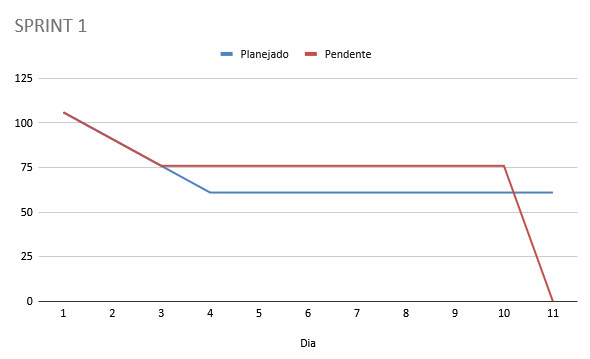
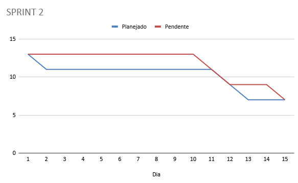
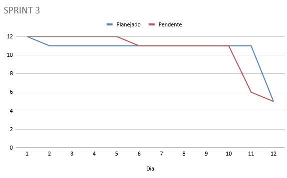
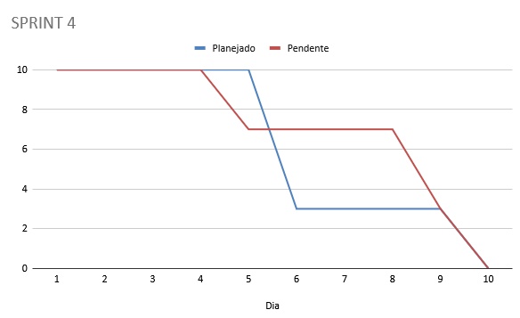
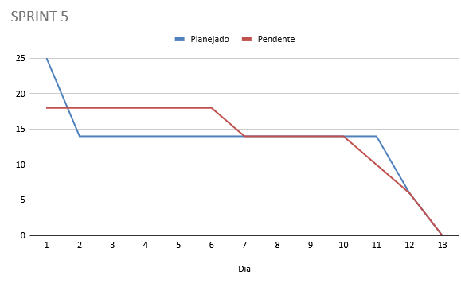

# Burndown
O documento a seguir, produzido por [Gustavo Maia](https://github.com/gusttavokr), apresenta os gráficos de desempenho burndown das sprints realizadas no projeto Pulso.

## Sprint 1
### 12/03/2026 - 23/03/2026
Refatoração do Back-end e Front-End.

| **Dia** | **Planejado** | **Restante** |
| ------- | ------------- | ------------ |
| 01      | 106 pts       | 106 pts      |
| 02      | 91 pts        | 91 pts       |
| 03      | 76 pts        | 76 pts       |
| 04      | 61 pts        | 76 pts       |
| 05      | 61 pts        | 76 pts       |
| 06      | 61 pts        | 76 pts       |
| 07      | 61 pts        | 76 pts       |
| 08      | 61 pts        | 76 pts       |
| 09      | 61 pts        | 76 pts       |
| 10      | 61 pts        | 76 pts       |
| 11      | 61 pts        | 0 pts        |

## Sprint 2
### 26/03/2026 - 09/04/2026
Inicialização da Avaliação Heurísitca e Documento de Partes Interessadas.

| **Dia** | **Planejado** | **Restante** |
| ------- | ------------- | ------------ |
| 01      | 13 pts        | 13 pts       |
| 02      | 11 pts        | 13 pts       |
| 03      | 11 pts        | 13 pts       |
| 04      | 11 pts        | 13 pts       |
| 05      | 11 pts        | 13 pts       |
| 06      | 11 pts        | 13 pts       |
| 07      | 11 pts        | 13 pts       |
| 08      | 11 pts        | 13 pts       |
| 09      | 11 pts        | 13 pts       |
| 10      | 11 pts        | 13 pts       |
| 11      | 11 pts        | 11 pts       |
| 12      | 9 pts         | 9 pts        |
| 13      | 7 pts         | 9 pts        |
| 14      | 7 pts         | 9 pts        |
| 15      | 7 pts         | 7 pts        |

## Sprint 3
### 09/04/2026 - 23/04/2026
Escrita do Documento de Casos de Teste.

| **Dia** | **Planejado** | **Restante** |
| ------- | ------------- | ------------ |
| 01      | 12 pts        | 12 pts       |
| 02      | 11 pts        | 12 pts       |
| 03      | 11 pts        | 12 pts       |
| 04      | 11 pts        | 12 pts       |
| 05      | 11 pts        | 12 pts       |
| 06      | 11 pts        | 11 pts       |
| 07      | 11 pts        | 11 pts       |
| 08      | 11 pts        | 11 pts       |
| 09      | 11 pts        | 11 pts       |
| 10      | 11 pts        | 11 pts       |
| 11      | 11 pts        | 6 pts        |
| 12      | 5 pts         | 5 pts        |

## Sprint 4
### 23/04/2026 - 07/05/2026
Finalização da Avaliação Heurística.

| **Dia** | **Planejado** | **Restante** |
| ------- | ------------- | ------------ |
| 01      | 10 pts        | 10 pts       |
| 02      | 10 pts        | 10 pts       |
| 03      | 10 pts        | 10 pts       |
| 04      | 10 pts        | 10 pts       |
| 05      | 10 pts        | 7 pts        |
| 06      | 3 pts         | 7 pts        |
| 07      | 3 pts         | 7 pts        |
| 08      | 3 pts         | 7 pts        |
| 09      | 3 pts         | 3 pts        |
| 10      | 0 pts         | 0 pts        |

## Sprint 5
### 07/05/2026 - 21/05/2026
Escrita dos documentos da matéria de Gerência de Projetos e implementação da integração contínua (CI).

| **Dia** | **Planejado** | **Restante** |
| ------- | ------------- | ------------ |
| 01      | 25 pts        | 18 pts       |
| 02      | 14 pts        | 18 pts       |
| 03      | 14 pts        | 18 pts       |
| 04      | 14 pts        | 18 pts       |
| 05      | 14 pts        | 18 pts       |
| 06      | 14 pts        | 18 pts       |
| 07      | 14 pts        | 14 pts       |
| 08      | 14 pts        | 14 pts       |
| 09      | 14 pts        | 14 pts       |
| 10      | 14 pts        | 14 pts       |
| 11      | 14 pts        | 10 pts       |
| 12      | 06 pts        | 06 pts       |
| 13      | 00 pts        | 00 pts       |

