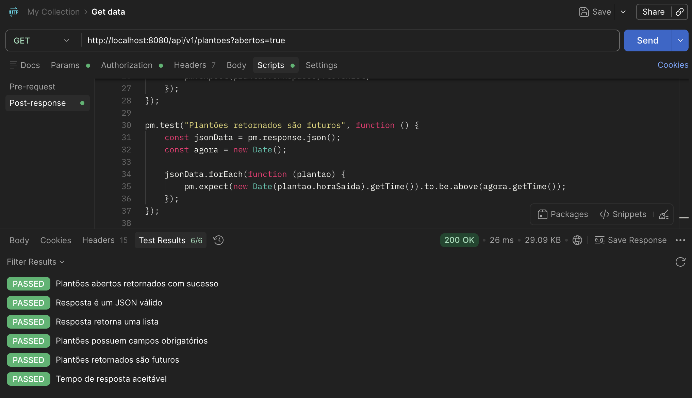
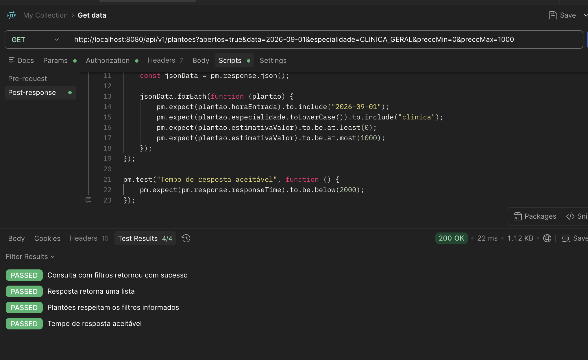
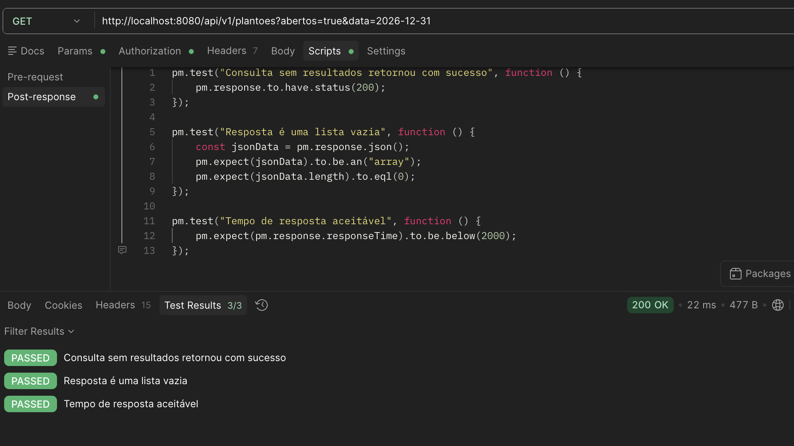
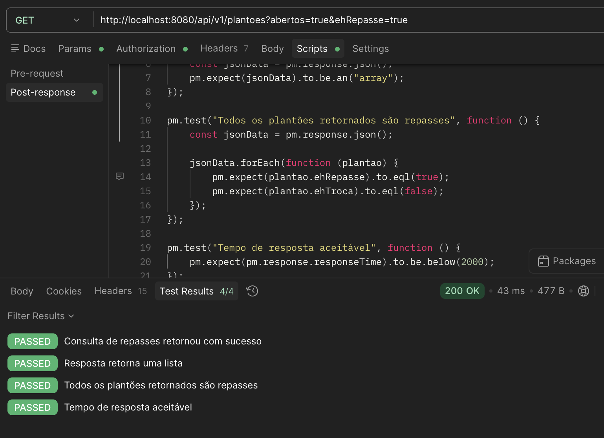
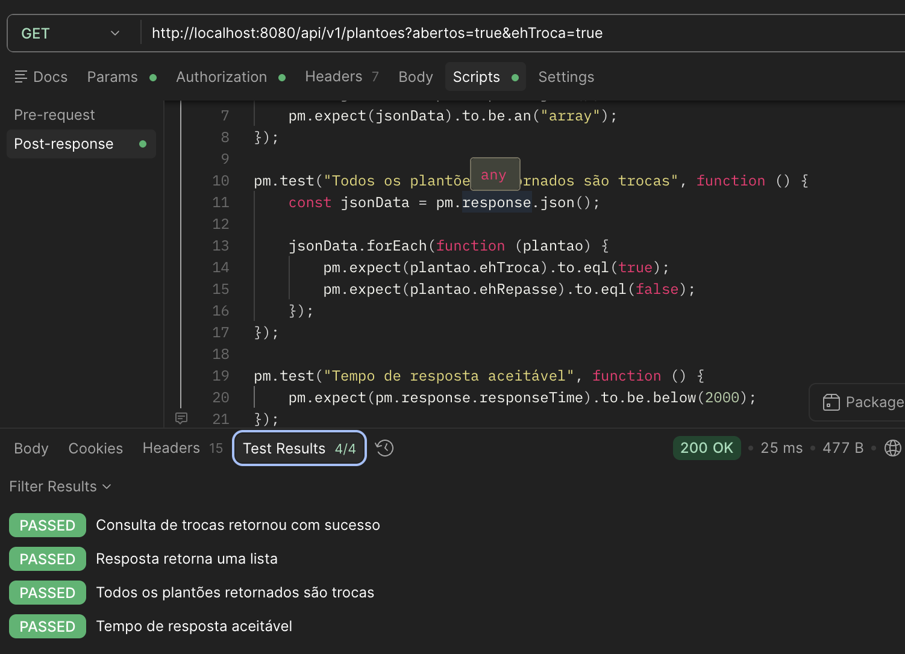
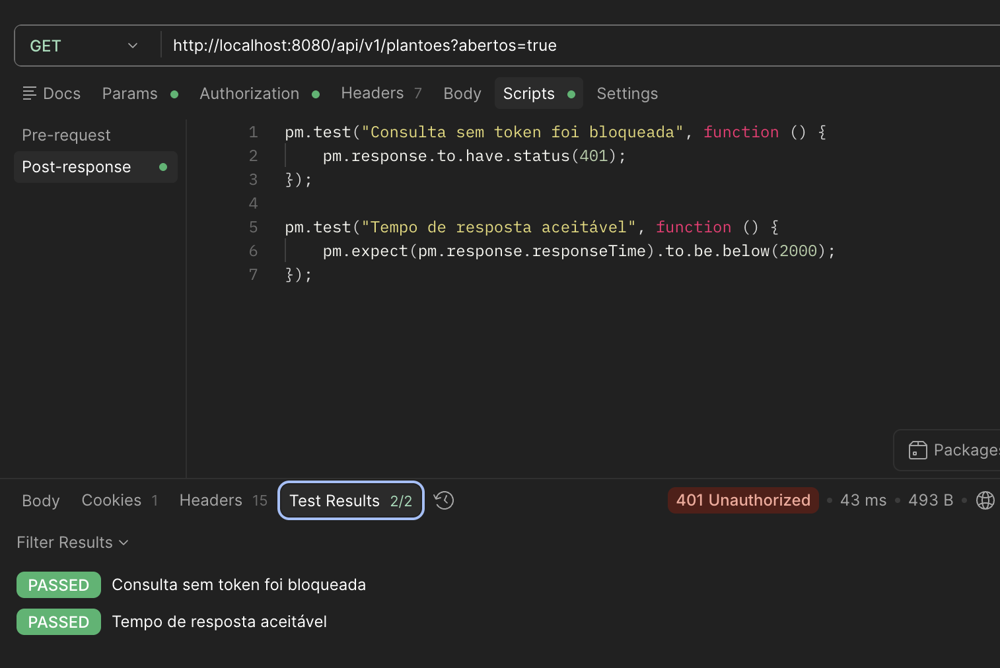
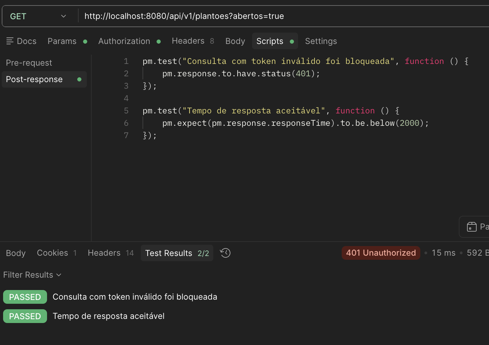
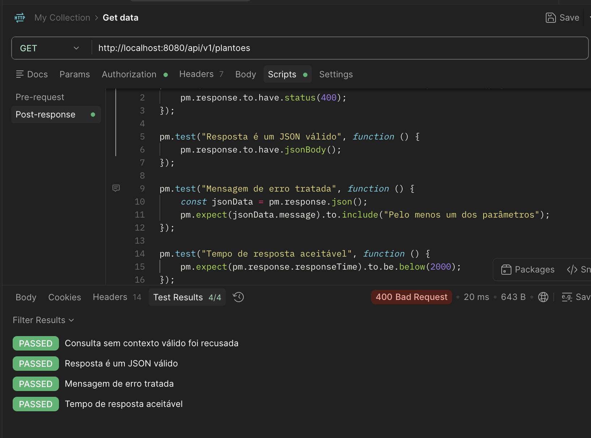
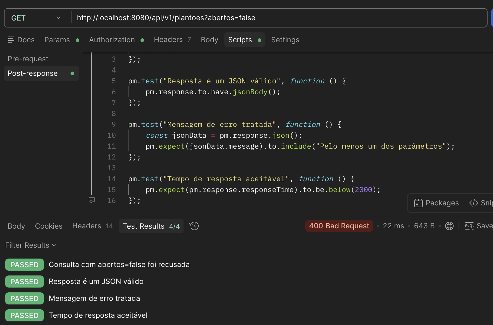

# Testes de API - Plantões Abertos e Pegar Plantão
Desenvolvido por: Asaph

## Introdução

Este documento reúne os testes de API elaborados para validar os fluxos de consultar plantões abertos e pegar plantão na aplicação Pulso, desenvolvida no contexto do PDS Corporativo.

Cada teste inclui informações detalhadas sobre o endpoint, os parâmetros ou corpo da requisição, a resposta esperada e o script de validação no Postman.

## CDU 07 - Consultar Plantões Abertos

### Objetivo

Validar se o médico autenticado consegue visualizar o feed de plantões abertos disponíveis, considerando apenas plantões futuros, de escalas publicadas, compatíveis com sua especialidade e com seu vínculo institucional.

### Fluxo Principal - Listar plantões abertos

#### Teste API 01 - Consultar Plantões Abertos com Sucesso

##### Objetivo do Teste

Validar que um médico autenticado consegue consultar os plantões abertos disponíveis para assumir.

##### Informações da Requisição

| Campo        | Valor                                      |
| ------------ | ------------------------------------------ |
| Método HTTP  | GET                                        |
| Endpoint     | `/api/v1/plantoes?abertos=true`            |
| Autenticação | Sim - Bearer Token                         |
| Caso de Uso  | CDU 07 - Consultar Plantões Abertos        |

##### Cabeçalhos da Requisição

```http
Authorization: Bearer <token>
Accept: application/json
```

##### Parâmetros da Requisição

| Parâmetro | Valor | Obrigatório | Descrição |
| --------- | ----- | ----------- | --------- |
| abertos | true | Sim | Indica que devem ser retornados apenas plantões abertos |

##### Resposta Esperada

**Status Code:** `200 OK`

```json
[
  {
    "id": 94,
    "nomeInstituicao": "Clínica Vida",
    "fotoLider": "https://cdn.pixabay.com/photo/2018/03/17/12/12/portrait-3233851_1280.jpg",
    "nomeLider": "Lucas Almeida",
    "especialidade": "Clinica Geral",
    "horaEntrada": "2026-09-01T07:00:00",
    "horaSaida": "2026-09-01T13:00:00",
    "estimativaValor": 0,
    "ehNovoPlantao": true,
    "ehTroca": false,
    "ehRepasse": false
  }
]
```

##### Validações Realizadas

| Validação           | Descrição                                      |
| ------------------- | ---------------------------------------------- |
| Status Code         | Verificar retorno HTTP 200                     |
| Content-Type        | Verificar retorno JSON                         |
| JSON Válido         | Validar estrutura da resposta                  |
| Campos Obrigatórios | Verificar campos principais do plantão         |
| Regra de Negócio    | Validar que os itens retornados estão abertos  |
| Performance         | Tempo de resposta inferior a 2000 ms           |

##### Script de Teste (Postman)

```javascript
pm.test("Plantões abertos retornados com sucesso", function () {
    pm.response.to.have.status(200);
});

pm.test("Resposta é um JSON válido", function () {
    pm.response.to.have.jsonBody();
});

pm.test("Resposta retorna uma lista", function () {
    const jsonData = pm.response.json();
    pm.expect(jsonData).to.be.an("array");
});

pm.test("Plantões possuem campos obrigatórios", function () {
    const jsonData = pm.response.json();

    jsonData.forEach(function (plantao) {
        pm.expect(plantao.id).to.exist;
        pm.expect(plantao.nomeInstituicao).to.exist;
        pm.expect(plantao.especialidade).to.exist;
        pm.expect(plantao.horaEntrada).to.exist;
        pm.expect(plantao.horaSaida).to.exist;
        pm.expect(plantao.estimativaValor).to.exist;
        pm.expect(plantao.ehNovoPlantao).to.exist;
        pm.expect(plantao.ehTroca).to.exist;
        pm.expect(plantao.ehRepasse).to.exist;
    });
});

pm.test("Plantões retornados são futuros", function () {
    const jsonData = pm.response.json();
    const agora = new Date();

    jsonData.forEach(function (plantao) {
        pm.expect(new Date(plantao.horaSaida).getTime()).to.be.above(agora.getTime());
    });
});

pm.test("Tempo de resposta aceitável", function () {
    pm.expect(pm.response.responseTime).to.be.below(2000);
});
```

##### Resultado Obtido

| Item                  | Resultado |
| --------------------- | --------- |
| Status Code           | PASSED     |
| Estrutura da Resposta | PASSED     |
| Regras de Negócio     | PASSED     |
| Performance           | PASSED     |

##### Evidências



### Fluxo Alternativo 01 - Consultar plantões abertos com filtros

#### Teste API 02 - Consultar Plantões Abertos Filtrando por Data, Especialidade e Valor

##### Objetivo do Teste

Validar que o médico autenticado consegue consultar plantões abertos aplicando filtros opcionais, retornando apenas os plantões compatíveis com os critérios informados.

##### Informações da Requisição

| Campo        | Valor                                                                                                                |
| ------------ | -------------------------------------------------------------------------------------------------------------------- |
| Método HTTP  | GET                                                                                                                  |
| Endpoint     | `/api/v1/plantoes?abertos=true&data=2026-09-01&especialidade=CLINICA_GERAL&precoMin=0&precoMax=1000`                 |
| Autenticação | Sim - Bearer Token                                                                                                   |
| Caso de Uso  | CDU 07 - Consultar Plantões Abertos                                                                                  |

##### Cabeçalhos da Requisição

```http
Authorization: Bearer <token>
Accept: application/json
```

##### Parâmetros da Requisição

| Parâmetro | Valor | Obrigatório | Descrição |
| --------- | ----- | ----------- | --------- |
| abertos | true | Sim | Indica consulta de plantões abertos |
| data | 2026-09-01 | Não | Filtra plantões pela data informada |
| especialidade | CLINICA_GERAL | Não | Filtra plantões pela especialidade |
| precoMin | 0 | Não | Valor mínimo estimado |
| precoMax | 1000 | Não | Valor máximo estimado |

##### Resposta Esperada

**Status Code:** `200 OK`

```json
[
  {
    "id": 94,
    "nomeInstituicao": "Clínica Vida",
    "fotoLider": "https://cdn.pixabay.com/photo/2018/03/17/12/12/portrait-3233851_1280.jpg",
    "nomeLider": "Lucas Almeida",
    "especialidade": "Clinica Geral",
    "horaEntrada": "2026-09-01T07:00:00",
    "horaSaida": "2026-09-01T13:00:00",
    "estimativaValor": 0,
    "ehNovoPlantao": true,
    "ehTroca": false,
    "ehRepasse": false
  }
]
```

##### Validações Realizadas

| Validação       | Descrição                                      |
| --------------- | ---------------------------------------------- |
| Status Code     | Verificar retorno HTTP 200                     |
| JSON Válido     | Validar estrutura da resposta                  |
| Filtro de Data  | Verificar se os plantões são da data informada |
| Filtro de Valor | Verificar se o valor está dentro da faixa      |
| Performance     | Tempo de resposta inferior a 2000 ms           |

##### Script de Teste (Postman)

```javascript
pm.test("Consulta com filtros retornou com sucesso", function () {
    pm.response.to.have.status(200);
});

pm.test("Resposta retorna uma lista", function () {
    const jsonData = pm.response.json();
    pm.expect(jsonData).to.be.an("array");
});

pm.test("Plantões respeitam os filtros informados", function () {
    const jsonData = pm.response.json();

    jsonData.forEach(function (plantao) {
        pm.expect(plantao.horaEntrada).to.include("2026-09-01");
        pm.expect(plantao.especialidade.toLowerCase()).to.include("clinica");
        pm.expect(plantao.estimativaValor).to.be.at.least(0);
        pm.expect(plantao.estimativaValor).to.be.at.most(1000);
    });
});

pm.test("Tempo de resposta aceitável", function () {
    pm.expect(pm.response.responseTime).to.be.below(2000);
});
```

##### Resultado Obtido

| Item                  | Resultado |
| --------------------- | --------- |
| Status Code           | PASSED     |
| Estrutura da Resposta | PASSED     |
| Filtros               | PASSED     |
| Performance           | PASSED     |


##### Evidências



### Fluxo Alternativo 02 - Consultar plantões abertos sem resultados

#### Teste API 03 - Consultar Plantões Abertos sem Plantões Disponíveis

##### Objetivo do Teste

Validar que a API retorna uma lista vazia quando não existem plantões abertos compatíveis com o médico logado ou com os filtros informados.

##### Informações da Requisição

| Campo        | Valor                                      |
| ------------ | ------------------------------------------ |
| Método HTTP  | GET                                        |
| Endpoint     | `/api/v1/plantoes?abertos=true&data=2026-12-31` |
| Autenticação | Sim - Bearer Token                         |
| Caso de Uso  | CDU 07 - Consultar Plantões Abertos        |

##### Cabeçalhos da Requisição

```http
Authorization: Bearer <token>
Accept: application/json
```

##### Resposta Esperada

**Status Code:** `200 OK`

```json
[]
```

##### Validações Realizadas

| Validação   | Descrição                            |
| ----------- | ------------------------------------ |
| Status Code | Verificar retorno HTTP 200           |
| JSON Válido | Validar retorno como lista JSON      |
| Lista Vazia | Verificar que nenhum item foi listado |
| Performance | Tempo de resposta inferior a 2000 ms |

##### Script de Teste (Postman)

```javascript
pm.test("Consulta sem resultados retornou com sucesso", function () {
    pm.response.to.have.status(200);
});

pm.test("Resposta é uma lista vazia", function () {
    const jsonData = pm.response.json();
    pm.expect(jsonData).to.be.an("array");
    pm.expect(jsonData.length).to.eql(0);
});

pm.test("Tempo de resposta aceitável", function () {
    pm.expect(pm.response.responseTime).to.be.below(2000);
});
```

##### Resultado Obtido

| Item                  | Resultado |
| --------------------- | --------- |
| Status Code           | PASSED       |
| Estrutura da Resposta | PASSED    |
| Lista Vazia           | PASSED    |
| Performance           | PASSED      |

##### Evidências



### Fluxo Alternativo 03 - Consultar plantões abertos de repasse

#### Teste API 04 - Consultar Plantões Abertos Filtrando por Repasse

##### Objetivo do Teste

Validar que o médico autenticado consegue consultar apenas plantões abertos classificados como repasse.

##### Informações da Requisição

| Campo        | Valor                                      |
| ------------ | ------------------------------------------ |
| Método HTTP  | GET                                        |
| Endpoint     | `/api/v1/plantoes?abertos=true&ehRepasse=true` |
| Autenticação | Sim - Bearer Token                         |
| Caso de Uso  | CDU 07 - Consultar Plantões Abertos        |

##### Cabeçalhos da Requisição

```http
Authorization: Bearer <token>
Accept: application/json
```

##### Resposta Esperada

**Status Code:** `200 OK`

```json
[
  {
    "id": 120,
    "nomeInstituicao": "Clínica Vida",
    "fotoLider": "https://cdn.pixabay.com/photo/2018/03/17/12/12/portrait-3233851_1280.jpg",
    "nomeLider": "Lucas Almeida",
    "especialidade": "Clinica Geral",
    "horaEntrada": "2026-09-05T19:00:00",
    "horaSaida": "2026-09-06T07:00:00",
    "estimativaValor": 800,
    "ehNovoPlantao": false,
    "ehTroca": false,
    "ehRepasse": true
  }
]
```

##### Validações Realizadas

| Validação        | Descrição                                      |
| ---------------- | ---------------------------------------------- |
| Status Code      | Verificar retorno HTTP 200                     |
| JSON Válido      | Validar estrutura da resposta                  |
| Filtro Repasse   | Verificar se `ehRepasse` está como true        |
| Regra de Negócio | Verificar se não retorna plantão comum ou troca |
| Performance      | Tempo de resposta inferior a 2000 ms           |

##### Script de Teste (Postman)

```javascript
pm.test("Consulta de repasses retornou com sucesso", function () {
    pm.response.to.have.status(200);
});

pm.test("Resposta retorna uma lista", function () {
    const jsonData = pm.response.json();
    pm.expect(jsonData).to.be.an("array");
});

pm.test("Todos os plantões retornados são repasses", function () {
    const jsonData = pm.response.json();

    jsonData.forEach(function (plantao) {
        pm.expect(plantao.ehRepasse).to.eql(true);
        pm.expect(plantao.ehTroca).to.eql(false);
    });
});

pm.test("Tempo de resposta aceitável", function () {
    pm.expect(pm.response.responseTime).to.be.below(2000);
});
```

##### Resultado Obtido

| Item                  | Resultado |
| --------------------- | --------- |
| Status Code           | PASSED      |
| Estrutura da Resposta | PASSED      |
| Filtro Repasse        | PASSED      |
| Performance           | PASSED      |

##### Evidências



### Fluxo Alternativo 04 - Consultar plantões abertos de troca

#### Teste API 05 - Consultar Plantões Abertos Filtrando por Troca

##### Objetivo do Teste

Validar que o médico autenticado consegue consultar apenas plantões abertos classificados como troca.

##### Informações da Requisição

| Campo        | Valor                                    |
| ------------ | ---------------------------------------- |
| Método HTTP  | GET                                      |
| Endpoint     | `/api/v1/plantoes?abertos=true&ehTroca=true` |
| Autenticação | Sim - Bearer Token                       |
| Caso de Uso  | CDU 07 - Consultar Plantões Abertos      |

##### Cabeçalhos da Requisição

```http
Authorization: Bearer <token>
Accept: application/json
```

##### Resposta Esperada

**Status Code:** `200 OK`

```json
[
  {
    "id": 121,
    "nomeInstituicao": "Clínica Vida",
    "fotoLider": "https://cdn.pixabay.com/photo/2018/03/17/12/12/portrait-3233851_1280.jpg",
    "nomeLider": "Lucas Almeida",
    "especialidade": "Clinica Geral",
    "horaEntrada": "2026-09-08T07:00:00",
    "horaSaida": "2026-09-08T13:00:00",
    "estimativaValor": 800,
    "ehNovoPlantao": false,
    "ehTroca": true,
    "ehRepasse": false
  }
]
```

##### Validações Realizadas

| Validação        | Descrição                                        |
| ---------------- | ------------------------------------------------ |
| Status Code      | Verificar retorno HTTP 200                       |
| JSON Válido      | Validar estrutura da resposta                    |
| Filtro Troca     | Verificar se `ehTroca` está como true            |
| Regra de Negócio | Verificar se não retorna plantão comum ou repasse |
| Performance      | Tempo de resposta inferior a 2000 ms             |

##### Script de Teste (Postman)

```javascript
pm.test("Consulta de trocas retornou com sucesso", function () {
    pm.response.to.have.status(200);
});

pm.test("Resposta retorna uma lista", function () {
    const jsonData = pm.response.json();
    pm.expect(jsonData).to.be.an("array");
});

pm.test("Todos os plantões retornados são trocas", function () {
    const jsonData = pm.response.json();

    jsonData.forEach(function (plantao) {
        pm.expect(plantao.ehTroca).to.eql(true);
        pm.expect(plantao.ehRepasse).to.eql(false);
    });
});

pm.test("Tempo de resposta aceitável", function () {
    pm.expect(pm.response.responseTime).to.be.below(2000);
});
```

##### Resultado Obtido

| Item                  | Resultado |
| --------------------- | --------- |
| Status Code           | PASSED      |
| Estrutura da Resposta | PASSED      |
| Filtro Troca          | PASSED      |
| Performance           | PASSED      |

##### Evidências



---

## Fluxos de Exceção - Consultar Plantões Abertos

### Fluxo de Exceção 01 - Consultar plantões abertos sem autenticação

#### Teste API 06 - Consultar Plantões Abertos sem Token

##### Objetivo do Teste

Validar que a API bloqueia a consulta de plantões abertos quando a requisição não possui token de autenticação.

##### Informações da Requisição

| Campo        | Valor                           |
| ------------ | ------------------------------- |
| Método HTTP  | GET                             |
| Endpoint     | `/api/v1/plantoes?abertos=true` |
| Autenticação | Não                             |
| Caso de Uso  | CDU 07 - Consultar Plantões Abertos |

##### Cabeçalhos da Requisição

```http
Accept: application/json
```

##### Resposta Esperada

**Status Code:** `401 Unauthorized`

```json
{
  "status": 401,
  "message": "Usuário não autenticado",
  "path": "/api/v1/plantoes"
}
```

##### Validações Realizadas

| Validação   | Descrição                            |
| ----------- | ------------------------------------ |
| Status Code | Verificar retorno HTTP 401           |
| Segurança   | Validar bloqueio de acesso sem token |
| Performance | Tempo de resposta inferior a 2000 ms |

##### Script de Teste (Postman)

```javascript
pm.test("Consulta sem token foi bloqueada", function () {
    pm.response.to.have.status(401);
});

pm.test("Tempo de resposta aceitável", function () {
    pm.expect(pm.response.responseTime).to.be.below(2000);
});
```

##### Resultado Obtido

| Item        | Resultado |
| ----------- | --------- |
| Status Code | PASSED      |
| Segurança   | PASSED      |
| Performance | PASSED      |

##### Evidências



### Fluxo de Exceção 02 - Consultar plantões abertos com token inválido

#### Teste API 07 - Consultar Plantões Abertos com Token Inválido

##### Objetivo do Teste

Validar que a API bloqueia a consulta quando o token informado é inválido, expirado ou malformado.

##### Informações da Requisição

| Campo        | Valor                           |
| ------------ | ------------------------------- |
| Método HTTP  | GET                             |
| Endpoint     | `/api/v1/plantoes?abertos=true` |
| Autenticação | Sim - Bearer Token inválido     |
| Caso de Uso  | CDU 07 - Consultar Plantões Abertos |

##### Cabeçalhos da Requisição

```http
Authorization: Bearer token_invalido
Accept: application/json
```

##### Resposta Esperada

**Status Code:** `401 Unauthorized`

```json
{
  "status": 401,
  "message": "Token inválido ou expirado",
  "path": "/api/v1/plantoes"
}
```

##### Validações Realizadas

| Validação   | Descrição                                    |
| ----------- | -------------------------------------------- |
| Status Code | Verificar retorno HTTP 401                   |
| Segurança   | Validar bloqueio de acesso com token inválido |
| Performance | Tempo de resposta inferior a 2000 ms         |

##### Script de Teste (Postman)

```javascript
pm.test("Consulta com token inválido foi bloqueada", function () {
    pm.response.to.have.status(401);
});

pm.test("Tempo de resposta aceitável", function () {
    pm.expect(pm.response.responseTime).to.be.below(2000);
});
```

##### Resultado Obtido

| Item        | Resultado |
| ----------- | --------- |
| Status Code | PASSED      |
| Segurança   | PASSED      |
| Performance | PASSED      |

##### Evidências



### Fluxo de Exceção 03 - Consultar plantões sem informar contexto válido

#### Teste API 09 - Consultar Plantões sem Parâmetro de Contexto

##### Objetivo do Teste

Validar que a API retorna erro quando a consulta é feita sem informar nenhum contexto válido de listagem, como `abertos=true`, `profissional=true`, `liderEscala=true` ou `instituicao=true`.

##### Informações da Requisição

| Campo        | Valor              |
| ------------ | ------------------ |
| Método HTTP  | GET                |
| Endpoint     | `/api/v1/plantoes` |
| Autenticação | Sim - Bearer Token |
| Caso de Uso  | CDU 07 - Consultar Plantões Abertos |

##### Cabeçalhos da Requisição

```http
Authorization: Bearer <token>
Accept: application/json
```

##### Resposta Esperada

**Status Code:** `400 Bad Request`

```json
{
  "timestamp": "2026-06-18T10:30:00",
  "status": 400,
  "message": "Pelo menos um dos parâmetros 'profissional', 'liderEscala' ou 'instituicao' deve ser true.",
  "path": "/api/v1/plantoes"
}
```

##### Validações Realizadas

| Validação        | Descrição                                      |
| ---------------- | ---------------------------------------------- |
| Status Code      | Verificar retorno HTTP 400                     |
| JSON Válido      | Validar estrutura da resposta                  |
| Mensagem de Erro | Validar mensagem de contexto obrigatório        |
| Performance      | Tempo de resposta inferior a 2000 ms           |

##### Script de Teste (Postman)

```javascript
pm.test("Consulta sem contexto válido foi recusada", function () {
    pm.response.to.have.status(400);
});

pm.test("Resposta é um JSON válido", function () {
    pm.response.to.have.jsonBody();
});

pm.test("Mensagem de erro tratada", function () {
    const jsonData = pm.response.json();
    pm.expect(jsonData.message).to.include("Pelo menos um dos parâmetros");
});

pm.test("Tempo de resposta aceitável", function () {
    pm.expect(pm.response.responseTime).to.be.below(2000);
});
```

##### Resultado Obtido

| Item             | Resultado |
| ---------------- | --------- |
| Status Code      | PASSED      |
| Estrutura        | PASSED      |
| Mensagem de Erro | PASSED      |
| Performance      | PASSED      |

##### Evidências



### Fluxo de Exceção 04 - Consultar plantões com contexto inválido

#### Teste API 10 - Consultar Plantões Abertos com `abertos=false`

##### Objetivo do Teste

Validar que a API retorna erro quando o parâmetro `abertos` é informado como `false` sem outro contexto válido para a listagem.

##### Informações da Requisição

| Campo        | Valor                            |
| ------------ | -------------------------------- |
| Método HTTP  | GET                              |
| Endpoint     | `/api/v1/plantoes?abertos=false` |
| Autenticação | Sim - Bearer Token               |
| Caso de Uso  | CDU 07 - Consultar Plantões Abertos |

##### Cabeçalhos da Requisição

```http
Authorization: Bearer <token>
Accept: application/json
```

##### Resposta Esperada

**Status Code:** `400 Bad Request`

```json
{
  "timestamp": "2026-06-18T10:30:00",
  "status": 400,
  "message": "Pelo menos um dos parâmetros 'profissional', 'liderEscala' ou 'instituicao' deve ser true.",
  "path": "/api/v1/plantoes"
}
```

##### Validações Realizadas

| Validação        | Descrição                                      |
| ---------------- | ---------------------------------------------- |
| Status Code      | Verificar retorno HTTP 400                     |
| JSON Válido      | Validar estrutura da resposta                  |
| Mensagem de Erro | Validar mensagem de contexto obrigatório        |
| Performance      | Tempo de resposta inferior a 2000 ms           |

##### Script de Teste (Postman)

```javascript
pm.test("Consulta com abertos=false foi recusada", function () {
    pm.response.to.have.status(400);
});

pm.test("Resposta é um JSON válido", function () {
    pm.response.to.have.jsonBody();
});

pm.test("Mensagem de erro tratada", function () {
    const jsonData = pm.response.json();
    pm.expect(jsonData.message).to.include("Pelo menos um dos parâmetros");
});

pm.test("Tempo de resposta aceitável", function () {
    pm.expect(pm.response.responseTime).to.be.below(2000);
});
```

##### Resultado Obtido

| Item             | Resultado |
| ---------------- | --------- |
| Status Code      | PASSED      |
| Estrutura        | PASSED      |
| Mensagem de Erro | PASSED      |
| Performance      | PASSED      |

##### Evidências

