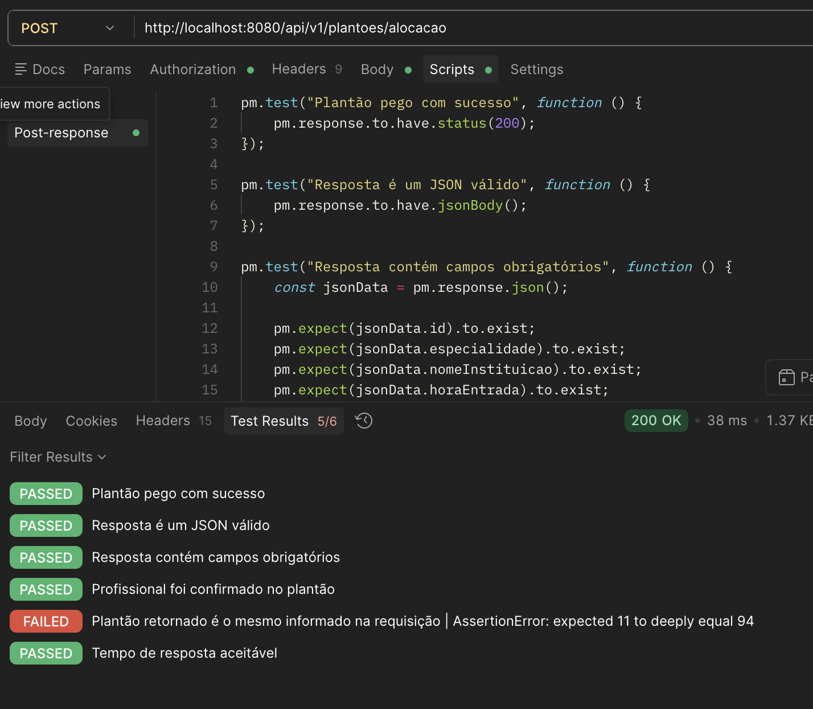
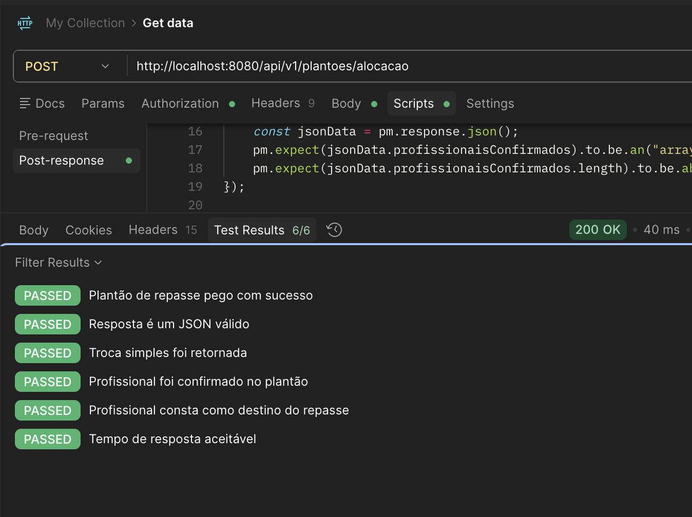
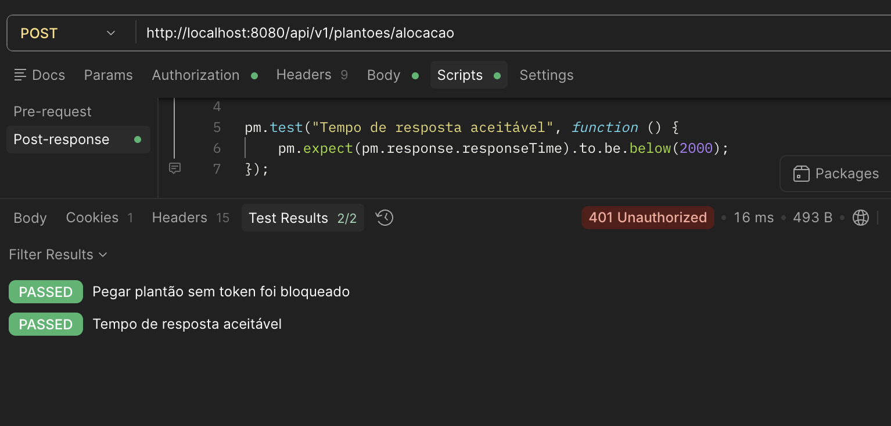
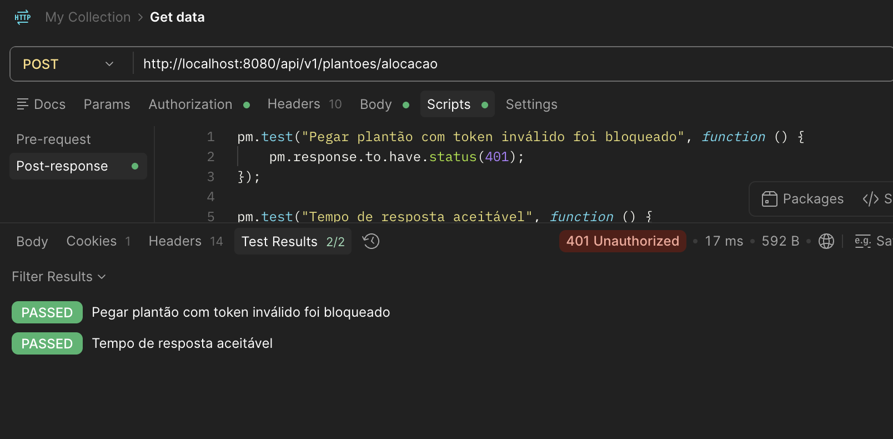
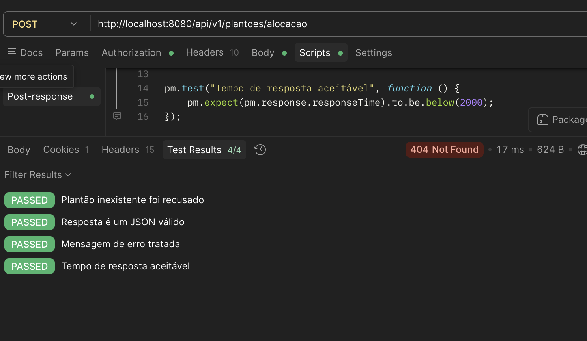
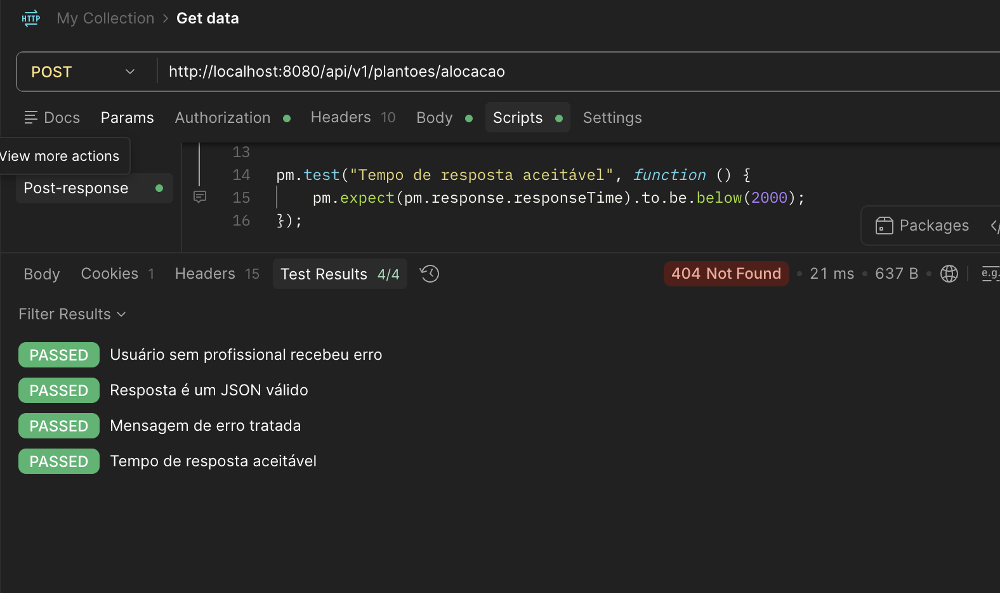
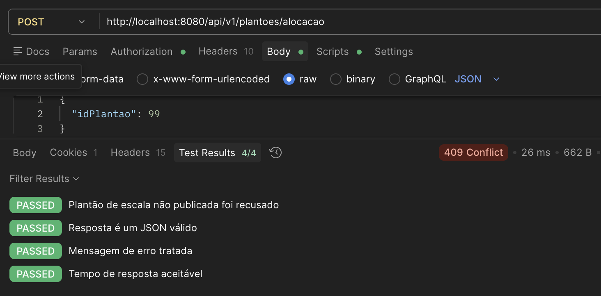
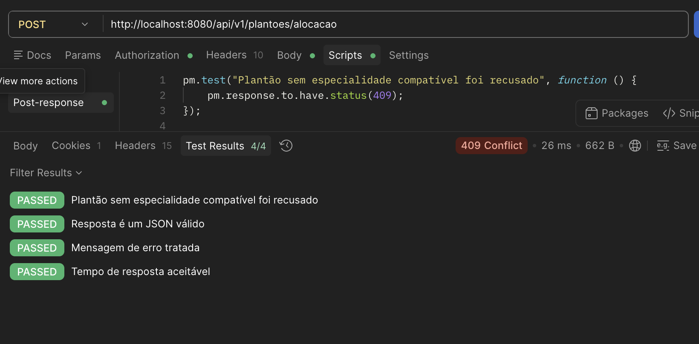
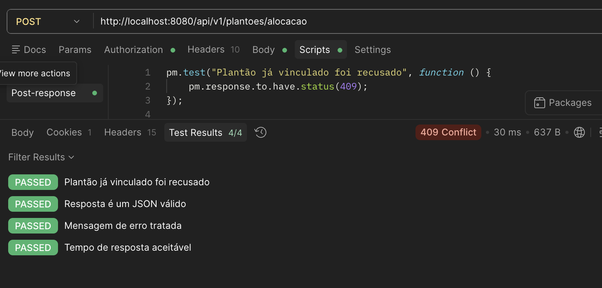
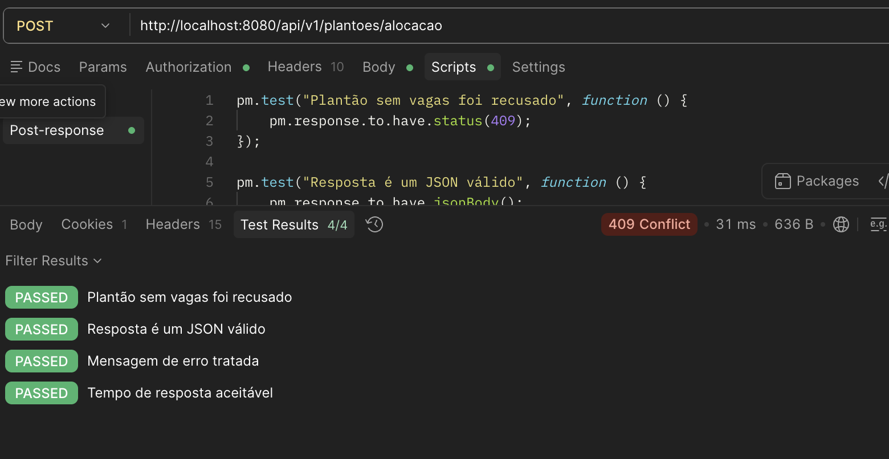

# Testes de API - Pegar Plantão
Desenvolvido por: Asaph

## Introdução

Este documento reúne os testes de API elaborados para validar o fluxo de pegar plantão na aplicação Pulso, desenvolvida no contexto do PDS Corporativo.

Cada teste inclui informações detalhadas sobre o endpoint, o corpo da requisição, a resposta esperada, as validações realizadas e o script de validação no Postman.

## CDU 06 - Pegar Plantão

### Objetivo

Validar se o médico autenticado consegue assumir um plantão aberto disponível, desde que o plantão exista, esteja disponível, seja compatível com sua especialidade e possa ser vinculado ao profissional logado.

### Fluxo Principal - Pegar plantão comum

#### Teste API 01 - Pegar Plantão com Sucesso

##### Objetivo do Teste

Validar que um médico autenticado consegue pegar um plantão aberto comum, passando a constar na lista de profissionais confirmados do plantão.

##### Informações da Requisição

| Campo        | Valor                       |
| ------------ | --------------------------- |
| Método HTTP  | POST                        |
| Endpoint     | `/api/v1/plantoes/alocacao` |
| Autenticação | Sim - Bearer Token          |
| Caso de Uso  | CDU 06 - Pegar Plantão      |

##### Cabeçalhos da Requisição

```http
Authorization: Bearer <token>
Content-Type: application/json
Accept: application/json
```

##### Corpo da Requisição

```json
{
  "idPlantao": 10
}
```

##### Resposta Esperada

**Status Code:** `200 OK`

```json
{
  "id": 94,
  "especialidade": "CLINICA_GERAL",
  "nomeInstituicao": "Clínica Vida",
  "horaEntrada": "2026-09-01T07:00:00",
  "horaSaida": "2026-09-01T13:00:00",
  "idLider": 1,
  "fotoLider": "https://cdn.pixabay.com/photo/2018/03/17/12/12/portrait-3233851_1280.jpg",
  "nomeLider": "Lucas Almeida",
  "nomeSetor": "Pronto Atendimento",
  "enderecoInstituicao": "Av. Central, 1000",
  "comentario": "Plantão disponível",
  "formaPagamento": "PIX",
  "estimativaValor": 0,
  "comentarioTroca": null,
  "tipoTroca": null,
  "idEscala": 3,
  "statusEscala": "PUBLICADA",
  "quantidadeProfissionais": 1,
  "estimativaPagamento": "2026-09-30",
  "profissionaisCombinados": [],
  "profissionaisConfirmados": [
    {
      "id": 5,
      "nome": "Asaph Oliveira",
      "fotoPerfil": "https://cdn.pixabay.com/photo/2018/03/17/12/12/portrait-3233851_1280.jpg"
    }
  ],
  "profissionaisTrocaDestino": []
}
```

##### Validações Realizadas

| Validação           | Descrição                                      |
| ------------------- | ---------------------------------------------- |
| Status Code         | Verificar retorno HTTP 200                     |
| Content-Type        | Verificar retorno JSON                         |
| JSON Válido         | Validar estrutura da resposta                  |
| Campos Obrigatórios | Verificar dados principais do plantão          |
| Alocação            | Verificar profissional em `profissionaisConfirmados` |
| Performance         | Tempo de resposta inferior a 2000 ms           |

##### Script de Teste (Postman)

```javascript
pm.test("Plantão pego com sucesso", function () {
    pm.response.to.have.status(200);
});

pm.test("Resposta é um JSON válido", function () {
    pm.response.to.have.jsonBody();
});

pm.test("Resposta contém campos obrigatórios", function () {
    const jsonData = pm.response.json();

    pm.expect(jsonData.id).to.exist;
    pm.expect(jsonData.especialidade).to.exist;
    pm.expect(jsonData.nomeInstituicao).to.exist;
    pm.expect(jsonData.horaEntrada).to.exist;
    pm.expect(jsonData.horaSaida).to.exist;
    pm.expect(jsonData.statusEscala).to.exist;
    pm.expect(jsonData.profissionaisConfirmados).to.exist;
});

pm.test("Profissional foi confirmado no plantão", function () {
    const jsonData = pm.response.json();

    pm.expect(jsonData.profissionaisConfirmados).to.be.an("array");
    pm.expect(jsonData.profissionaisConfirmados.length).to.be.above(0);
});

pm.test("Plantão retornado é o mesmo informado na requisição", function () {
    const jsonData = pm.response.json();
    pm.expect(jsonData.id).to.eql(94);
});

pm.test("Tempo de resposta aceitável", function () {
    pm.expect(pm.response.responseTime).to.be.below(2000);
});
```

##### Resultado Obtido

| Item                  | Resultado |
| --------------------- | --------- |
| Status Code           | PASSED      |
| Estrutura da Resposta | RECUSED      |
| Alocação              | PASSED      |
| Performance           | PASSED     |

##### Evidências



---

## Fluxo Alternativo - Pegar plantão de repasse

### Teste API 02 - Pegar Plantão de Repasse com Sucesso

##### Objetivo do Teste

Validar que, ao pegar um plantão oriundo de repasse, o médico autenticado assume o plantão e a troca simples pendente é confirmada para o profissional logado.

##### Informações da Requisição

| Campo        | Valor                       |
| ------------ | --------------------------- |
| Método HTTP  | POST                        |
| Endpoint     | `/api/v1/plantoes/alocacao` |
| Autenticação | Sim - Bearer Token          |
| Caso de Uso  | CDU 06 - Pegar Plantão      |

##### Cabeçalhos da Requisição

```http
Authorization: Bearer <token>
Content-Type: application/json
Accept: application/json
```

##### Corpo da Requisição

```json
{
  "idPlantao": 120
}
```

##### Resposta Esperada

**Status Code:** `200 OK`

```json
{
  "id": 120,
  "especialidade": "CLINICA_GERAL",
  "nomeInstituicao": "Clínica Vida",
  "horaEntrada": "2026-09-05T19:00:00",
  "horaSaida": "2026-09-06T07:00:00",
  "idLider": 1,
  "fotoLider": "https://cdn.pixabay.com/photo/2018/03/17/12/12/portrait-3233851_1280.jpg",
  "nomeLider": "Lucas Almeida",
  "nomeSetor": "Pronto Atendimento",
  "enderecoInstituicao": "Av. Central, 1000",
  "comentario": "Plantão de repasse",
  "formaPagamento": "PIX",
  "estimativaValor": 800,
  "comentarioTroca": "Repasse por indisponibilidade",
  "tipoTroca": "SIMPLES",
  "idEscala": 3,
  "statusEscala": "PUBLICADA",
  "quantidadeProfissionais": 1,
  "estimativaPagamento": "2026-09-30",
  "profissionaisCombinados": [],
  "profissionaisConfirmados": [
    {
      "id": 5,
      "nome": "Asaph Oliveira",
      "fotoPerfil": "https://cdn.pixabay.com/photo/2018/03/17/12/12/portrait-3233851_1280.jpg"
    }
  ],
  "profissionaisTrocaDestino": [
    {
      "id": 5,
      "nome": "Asaph Oliveira",
      "fotoPerfil": "https://cdn.pixabay.com/photo/2018/03/17/12/12/portrait-3233851_1280.jpg"
    }
  ]
}
```

##### Validações Realizadas

| Validação       | Descrição                                      |
| --------------- | ---------------------------------------------- |
| Status Code     | Verificar retorno HTTP 200                     |
| JSON Válido     | Validar estrutura da resposta                  |
| Tipo de Troca   | Verificar `tipoTroca` como `SIMPLES`           |
| Alocação        | Verificar profissional em `profissionaisConfirmados` |
| Repasse         | Verificar profissional em `profissionaisTrocaDestino` |
| Performance     | Tempo de resposta inferior a 2000 ms           |

##### Script de Teste (Postman)

```javascript
pm.test("Plantão de repasse pego com sucesso", function () {
    pm.response.to.have.status(200);
});

pm.test("Resposta é um JSON válido", function () {
    pm.response.to.have.jsonBody();
});

pm.test("Troca simples foi retornada", function () {
    const jsonData = pm.response.json();
    pm.expect(jsonData.tipoTroca).to.eql("SIMPLES");
});

pm.test("Profissional foi confirmado no plantão", function () {
    const jsonData = pm.response.json();
    pm.expect(jsonData.profissionaisConfirmados).to.be.an("array");
    pm.expect(jsonData.profissionaisConfirmados.length).to.be.above(0);
});

pm.test("Profissional consta como destino do repasse", function () {
    const jsonData = pm.response.json();
    pm.expect(jsonData.profissionaisTrocaDestino).to.be.an("array");
    pm.expect(jsonData.profissionaisTrocaDestino.length).to.be.above(0);
});

pm.test("Tempo de resposta aceitável", function () {
    pm.expect(pm.response.responseTime).to.be.below(2000);
});
```

##### Resultado Obtido

| Item                  | Resultado |
| --------------------- | --------- |
| Status Code           | PASSED    |
| Estrutura da Resposta | PASSED       |
| Repasse               | PASSED      |
| Performance           | PASSED       |

##### Evidências



---

## Fluxos de Exceção - Pegar Plantão

### Fluxo de Exceção 01 - Pegar plantão sem autenticação

#### Teste API 03 - Pegar Plantão sem Token

##### Objetivo do Teste

Validar que a API bloqueia a tentativa de pegar plantão quando a requisição não possui token de autenticação.

##### Informações da Requisição

| Campo        | Valor                       |
| ------------ | --------------------------- |
| Método HTTP  | POST                        |
| Endpoint     | `/api/v1/plantoes/alocacao` |
| Autenticação | Não                         |
| Caso de Uso  | CDU 06 - Pegar Plantão      |

##### Cabeçalhos da Requisição

```http
Content-Type: application/json
Accept: application/json
```

##### Corpo da Requisição

```json
{
  "idPlantao": 94
}
```

##### Resposta Esperada

**Status Code:** `401 Unauthorized`

```json
{
  "status": 401,
  "message": "Usuário não autenticado",
  "path": "/api/v1/plantoes/alocacao"
}
```

##### Validações Realizadas

| Validação   | Descrição                            |
| ----------- | ------------------------------------ |
| Status Code | Verificar retorno HTTP 401           |
| Segurança   | Validar bloqueio de acesso sem token |
| Performance | Tempo de resposta inferior a 2000 ms |

##### Script de Teste (Postman)

```javascript
pm.test("Pegar plantão sem token foi bloqueado", function () {
    pm.response.to.have.status(401);
});

pm.test("Tempo de resposta aceitável", function () {
    pm.expect(pm.response.responseTime).to.be.below(2000);
});
```

##### Resultado Obtido

| Item        | Resultado |
| ----------- | --------- |
| Status Code | PASSED      |
| Segurança   | PASSED       |
| Performance | PASSED       |

##### Evidências



### Fluxo de Exceção 02 - Pegar plantão com token inválido

#### Teste API 04 - Pegar Plantão com Token Inválido

##### Objetivo do Teste

Validar que a API bloqueia a tentativa de pegar plantão quando o token informado é inválido, expirado ou malformado.

##### Informações da Requisição

| Campo        | Valor                       |
| ------------ | --------------------------- |
| Método HTTP  | POST                        |
| Endpoint     | `/api/v1/plantoes/alocacao` |
| Autenticação | Sim - Bearer Token inválido |
| Caso de Uso  | CDU 06 - Pegar Plantão      |

##### Cabeçalhos da Requisição

```http
Authorization: Bearer token_invalido
Content-Type: application/json
Accept: application/json
```

##### Corpo da Requisição

```json
{
  "idPlantao": 94
}
```

##### Resposta Esperada

**Status Code:** `401 Unauthorized`

```json
{
  "status": 401,
  "message": "Token inválido ou expirado",
  "path": "/api/v1/plantoes/alocacao"
}
```

##### Validações Realizadas

| Validação   | Descrição                                    |
| ----------- | -------------------------------------------- |
| Status Code | Verificar retorno HTTP 401                   |
| Segurança   | Validar bloqueio de acesso com token inválido |
| Performance | Tempo de resposta inferior a 2000 ms         |

##### Script de Teste (Postman)

```javascript
pm.test("Pegar plantão com token inválido foi bloqueado", function () {
    pm.response.to.have.status(401);
});

pm.test("Tempo de resposta aceitável", function () {
    pm.expect(pm.response.responseTime).to.be.below(2000);
});
```

##### Resultado Obtido

| Item        | Resultado |
| ----------- | --------- |
| Status Code | PASSED      |
| Segurança   | PASSED      |
| Performance | PASSED      |

##### Evidências



### Fluxo de Exceção 03 - Pegar plantão sem informar o ID do plantão

#### Teste API 05 - Pegar Plantão sem `idPlantao`

##### Objetivo do Teste

Validar que a API rejeita a requisição quando o identificador do plantão não é informado no corpo.

##### Informações da Requisição

| Campo        | Valor                       |
| ------------ | --------------------------- |
| Método HTTP  | POST                        |
| Endpoint     | `/api/v1/plantoes/alocacao` |
| Autenticação | Sim - Bearer Token          |
| Caso de Uso  | CDU 06 - Pegar Plantão      |

##### Cabeçalhos da Requisição

```http
Authorization: Bearer <token>
Content-Type: application/json
Accept: application/json
```

##### Corpo da Requisição

```json
{ }
```

##### Resposta Esperada

**Status Code:** `400 Bad Request`

```json
{
  "timestamp": "2026-06-20T10:30:00",
  "status": 400,
  "message": "O ID do plantão é obrigatório.",
  "path": "/api/v1/plantoes/alocacao"
}
```

##### Validações Realizadas

| Validação        | Descrição                                |
| ---------------- | ---------------------------------------- |
| Status Code      | Verificar retorno HTTP 400               |
| JSON Válido      | Validar estrutura da resposta            |
| Mensagem de Erro | Validar mensagem de campo obrigatório    |
| Performance      | Tempo de resposta inferior a 2000 ms     |

##### Script de Teste (Postman)

```javascript
pm.test("Requisição sem idPlantao foi recusada", function () {
    pm.response.to.have.status(400);
});

pm.test("Resposta é um JSON válido", function () {
    pm.response.to.have.jsonBody();
});

pm.test("Mensagem de erro tratada", function () {
    const jsonData = pm.response.json();
    pm.expect(jsonData.message).to.include("O ID do plantão é obrigatório");
});

pm.test("Tempo de resposta aceitável", function () {
    pm.expect(pm.response.responseTime).to.be.below(2000);
});
```

##### Resultado Obtido

| Item             | Resultado |
| ---------------- | --------- |
| Status Code      | RECUSED      |
| Estrutura        | RECUSED       |
| Mensagem de Erro | RECUSED      |
| Performance      | PASSED      |

##### Evidências


### Fluxo de Exceção 04 - Pegar plantão inexistente

#### Teste API 06 - Pegar Plantão com `idPlantao` Inexistente

##### Objetivo do Teste

Validar que a API retorna erro quando o médico tenta pegar um plantão que não existe.

##### Informações da Requisição

| Campo        | Valor                       |
| ------------ | --------------------------- |
| Método HTTP  | POST                        |
| Endpoint     | `/api/v1/plantoes/alocacao` |
| Autenticação | Sim - Bearer Token          |
| Caso de Uso  | CDU 06 - Pegar Plantão      |

##### Cabeçalhos da Requisição

```http
Authorization: Bearer <token>
Content-Type: application/json
Accept: application/json
```

##### Corpo da Requisição

```json
{
  "idPlantao": 9999
}
```

##### Resposta Esperada

**Status Code:** `404 Not Found`

```json
{
  "timestamp": "2026-06-20T10:30:00",
  "status": 404,
  "message": "Plantão não encontrado com ID 9999",
  "path": "/api/v1/plantoes/alocacao"
}
```

##### Validações Realizadas

| Validação        | Descrição                                |
| ---------------- | ---------------------------------------- |
| Status Code      | Verificar retorno HTTP 404               |
| JSON Válido      | Validar estrutura da resposta            |
| Mensagem de Erro | Validar mensagem de plantão inexistente  |
| Performance      | Tempo de resposta inferior a 2000 ms     |

##### Script de Teste (Postman)

```javascript
pm.test("Plantão inexistente foi recusado", function () {
    pm.response.to.have.status(404);
});

pm.test("Resposta é um JSON válido", function () {
    pm.response.to.have.jsonBody();
});

pm.test("Mensagem de erro tratada", function () {
    const jsonData = pm.response.json();
    pm.expect(jsonData.message).to.include("Plantão não encontrado");
});

pm.test("Tempo de resposta aceitável", function () {
    pm.expect(pm.response.responseTime).to.be.below(2000);
});
```

##### Resultado Obtido

| Item             | Resultado |
| ---------------- | --------- |
| Status Code      | PASSED      |
| Estrutura        | PASSED      |
| Mensagem de Erro | PASSED      |
| Performance      | PASSED      |

##### Evidências



### Fluxo de Exceção 05 - Pegar plantão com usuário sem profissional

#### Teste API 07 - Pegar Plantão com Usuário sem Profissional Associado

##### Objetivo do Teste

Validar que a API retorna erro quando o usuário autenticado não possui um profissional associado e tenta pegar um plantão.

##### Informações da Requisição

| Campo        | Valor                       |
| ------------ | --------------------------- |
| Método HTTP  | POST                        |
| Endpoint     | `/api/v1/plantoes/alocacao` |
| Autenticação | Sim - Bearer Token          |
| Caso de Uso  | CDU 06 - Pegar Plantão      |

##### Cabeçalhos da Requisição

```http
Authorization: Bearer <token_usuario_sem_profissional>
Content-Type: application/json
Accept: application/json
```

##### Corpo da Requisição

```json
{
  "idPlantao": 94
}
```

##### Resposta Esperada

**Status Code:** `404 Not Found`

```json
{
  "timestamp": "2026-06-20T10:30:00",
  "status": 404,
  "message": "Profissional não encontrado para o usuário ID 20",
  "path": "/api/v1/plantoes/alocacao"
}
```

##### Validações Realizadas

| Validação        | Descrição                                      |
| ---------------- | ---------------------------------------------- |
| Status Code      | Verificar retorno HTTP 404                     |
| JSON Válido      | Validar estrutura da resposta                  |
| Mensagem de Erro | Validar mensagem de profissional não encontrado |
| Performance      | Tempo de resposta inferior a 2000 ms           |

##### Script de Teste (Postman)

```javascript
pm.test("Usuário sem profissional recebeu erro", function () {
    pm.response.to.have.status(404);
});

pm.test("Resposta é um JSON válido", function () {
    pm.response.to.have.jsonBody();
});

pm.test("Mensagem de erro tratada", function () {
    const jsonData = pm.response.json();
    pm.expect(jsonData.message).to.include("Profissional não encontrado");
});

pm.test("Tempo de resposta aceitável", function () {
    pm.expect(pm.response.responseTime).to.be.below(2000);
});
```

##### Resultado Obtido

| Item             | Resultado |
| ---------------- | --------- |
| Status Code      | PASSED      |
| Estrutura        | PASSED      |
| Mensagem de Erro | PASSED      |
| Performance      | PASSED      |

##### Evidências



### Fluxo de Exceção 06 - Pegar plantão de escala não publicada

#### Teste API 08 - Pegar Plantão de Escala Não Publicada

##### Objetivo do Teste

Validar que a API impede que o médico pegue um plantão cuja escala não esteja publicada.

##### Informações da Requisição

| Campo        | Valor                       |
| ------------ | --------------------------- |
| Método HTTP  | POST                        |
| Endpoint     | `/api/v1/plantoes/alocacao` |
| Autenticação | Sim - Bearer Token          |
| Caso de Uso  | CDU 06 - Pegar Plantão      |

##### Cabeçalhos da Requisição

```http
Authorization: Bearer <token>
Content-Type: application/json
Accept: application/json
```

##### Corpo da Requisição

```json
{
  "idPlantao": 30
}
```

##### Resposta Esperada

**Status Code:** `409 Conflict`

```json
{
  "timestamp": "2026-06-20T10:30:00",
  "status": 409,
  "message": "Não é possível pegar um plantão de uma escala que não está publicada.",
  "path": "/api/v1/plantoes/alocacao"
}
```

##### Validações Realizadas

| Validação        | Descrição                                      |
| ---------------- | ---------------------------------------------- |
| Status Code      | Verificar retorno HTTP 409                     |
| JSON Válido      | Validar estrutura da resposta                  |
| Regra de Negócio | Validar bloqueio por escala não publicada      |
| Performance      | Tempo de resposta inferior a 2000 ms           |

##### Script de Teste (Postman)

```javascript
pm.test("Plantão de escala não publicada foi recusado", function () {
    pm.response.to.have.status(409);
});

pm.test("Resposta é um JSON válido", function () {
    pm.response.to.have.jsonBody();
});

pm.test("Mensagem de erro tratada", function () {
    const jsonData = pm.response.json();
    pm.expect(jsonData.message).to.include("escala que não está publicada");
});

pm.test("Tempo de resposta aceitável", function () {
    pm.expect(pm.response.responseTime).to.be.below(2000);
});
```

##### Resultado Obtido

| Item             | Resultado |
| ---------------- | --------- |
| Status Code      | PASSED      |
| Regra de Negócio | PASSED      |
| Mensagem de Erro | PASSED      |
| Performance      | PASSED      |

##### Evidências



### Fluxo de Exceção 07 - Pegar plantão sem especialidade compatível

#### Teste API 09 - Pegar Plantão sem Especialidade do Setor

##### Objetivo do Teste

Validar que a API impede que o médico pegue um plantão cuja especialidade do setor não está associada ao seu cadastro profissional.

##### Informações da Requisição

| Campo        | Valor                       |
| ------------ | --------------------------- |
| Método HTTP  | POST                        |
| Endpoint     | `/api/v1/plantoes/alocacao` |
| Autenticação | Sim - Bearer Token          |
| Caso de Uso  | CDU 06 - Pegar Plantão      |

##### Cabeçalhos da Requisição

```http
Authorization: Bearer <token_sem_especialidade>
Content-Type: application/json
Accept: application/json
```

##### Corpo da Requisição

```json
{
  "idPlantao": 94
}
```

##### Resposta Esperada

**Status Code:** `409 Conflict`

```json
{
  "timestamp": "2026-06-20T10:30:00",
  "status": 409,
  "message": "O profissional não possui a especialidade exigida pelo setor da escala.",
  "path": "/api/v1/plantoes/alocacao"
}
```

##### Validações Realizadas

| Validação        | Descrição                                      |
| ---------------- | ---------------------------------------------- |
| Status Code      | Verificar retorno HTTP 409                     |
| JSON Válido      | Validar estrutura da resposta                  |
| Regra de Negócio | Validar bloqueio por especialidade incompatível |
| Performance      | Tempo de resposta inferior a 2000 ms           |

##### Script de Teste (Postman)

```javascript
pm.test("Plantão sem especialidade compatível foi recusado", function () {
    pm.response.to.have.status(409);
});

pm.test("Resposta é um JSON válido", function () {
    pm.response.to.have.jsonBody();
});

pm.test("Mensagem de erro tratada", function () {
    const jsonData = pm.response.json();
    pm.expect(jsonData.message).to.include("especialidade exigida");
});

pm.test("Tempo de resposta aceitável", function () {
    pm.expect(pm.response.responseTime).to.be.below(2000);
});
```

##### Resultado Obtido

| Item             | Resultado |
| ---------------- | --------- |
| Status Code      | PASSED      |
| Regra de Negócio | PASSED      |
| Mensagem de Erro | PASSED      |
| Performance      | PASSED      |

##### Evidências



### Fluxo de Exceção 08 - Pegar plantão já vinculado ao profissional

#### Teste API 10 - Pegar Plantão Já Vinculado

##### Objetivo do Teste

Validar que a API impede que o profissional pegue novamente um plantão no qual ele já está confirmado ou combinado.

##### Informações da Requisição

| Campo        | Valor                       |
| ------------ | --------------------------- |
| Método HTTP  | POST                        |
| Endpoint     | `/api/v1/plantoes/alocacao` |
| Autenticação | Sim - Bearer Token          |
| Caso de Uso  | CDU 06 - Pegar Plantão      |

##### Cabeçalhos da Requisição

```http
Authorization: Bearer <token>
Content-Type: application/json
Accept: application/json
```

##### Corpo da Requisição

```json
{
  "idPlantao": 94
}
```

##### Resposta Esperada

**Status Code:** `409 Conflict`

```json
{
  "timestamp": "2026-06-20T10:30:00",
  "status": 409,
  "message": "O profissional já está vinculado a este plantão.",
  "path": "/api/v1/plantoes/alocacao"
}
```

##### Validações Realizadas

| Validação        | Descrição                                  |
| ---------------- | ------------------------------------------ |
| Status Code      | Verificar retorno HTTP 409                 |
| JSON Válido      | Validar estrutura da resposta              |
| Regra de Negócio | Validar bloqueio de alocação duplicada     |
| Performance      | Tempo de resposta inferior a 2000 ms       |

##### Script de Teste (Postman)

```javascript
pm.test("Plantão já vinculado foi recusado", function () {
    pm.response.to.have.status(409);
});

pm.test("Resposta é um JSON válido", function () {
    pm.response.to.have.jsonBody();
});

pm.test("Mensagem de erro tratada", function () {
    const jsonData = pm.response.json();
    pm.expect(jsonData.message).to.include("já está vinculado");
});

pm.test("Tempo de resposta aceitável", function () {
    pm.expect(pm.response.responseTime).to.be.below(2000);
});
```

##### Resultado Obtido

| Item             | Resultado |
| ---------------- | --------- |
| Status Code      | PASSED     |
| Regra de Negócio | PASSED     |
| Mensagem de Erro | PASSED     |
| Performance      | PASSED     |

##### Evidências



### Fluxo de Exceção 09 - Pegar plantão sem vagas disponíveis

#### Teste API 11 - Pegar Plantão sem Vagas

##### Objetivo do Teste

Validar que a API deve impedir que um médico pegue um plantão quando a quantidade máxima de profissionais já foi atingida.

##### Informações da Requisição

| Campo        | Valor                       |
| ------------ | --------------------------- |
| Método HTTP  | POST                        |
| Endpoint     | `/api/v1/plantoes/alocacao` |
| Autenticação | Sim - Bearer Token          |
| Caso de Uso  | CDU 06 - Pegar Plantão      |

##### Cabeçalhos da Requisição

```http
Authorization: Bearer <token>
Content-Type: application/json
Accept: application/json
```

##### Corpo da Requisição

```json
{
  "idPlantao": 95
}
```

##### Resposta Esperada

**Status Code:** `409 Conflict`

```json
{
  "timestamp": "2026-06-20T10:30:00",
  "status": 409,
  "message": "Não há vagas disponíveis para este plantão.",
  "path": "/api/v1/plantoes/alocacao"
}
```

##### Validações Realizadas

| Validação        | Descrição                                      |
| ---------------- | ---------------------------------------------- |
| Status Code      | Verificar retorno HTTP 409                     |
| JSON Válido      | Validar estrutura da resposta                  |
| Regra de Negócio | Validar bloqueio por ausência de vagas         |
| Performance      | Tempo de resposta inferior a 2000 ms           |

##### Script de Teste (Postman)

```javascript
pm.test("Plantão sem vagas foi recusado", function () {
    pm.response.to.have.status(409);
});

pm.test("Resposta é um JSON válido", function () {
    pm.response.to.have.jsonBody();
});

pm.test("Mensagem de erro tratada", function () {
    const jsonData = pm.response.json();
    pm.expect(jsonData.message).to.include("Não há vagas disponíveis");
});

pm.test("Tempo de resposta aceitável", function () {
    pm.expect(pm.response.responseTime).to.be.below(2000);
});
```

##### Resultado Obtido

| Item             | Resultado |
| ---------------- | --------- |
| Status Code      | PASSED      |
| Regra de Negócio | PASSED      |
| Mensagem de Erro | PASSED      |
| Performance      | PASSED      |

##### Evidências

