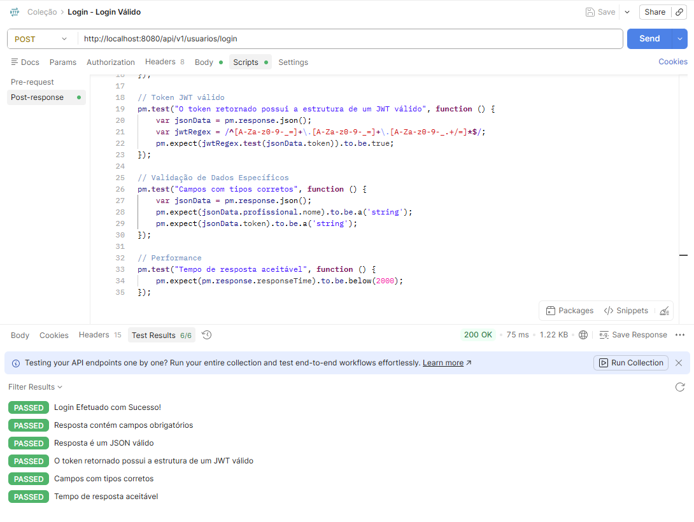
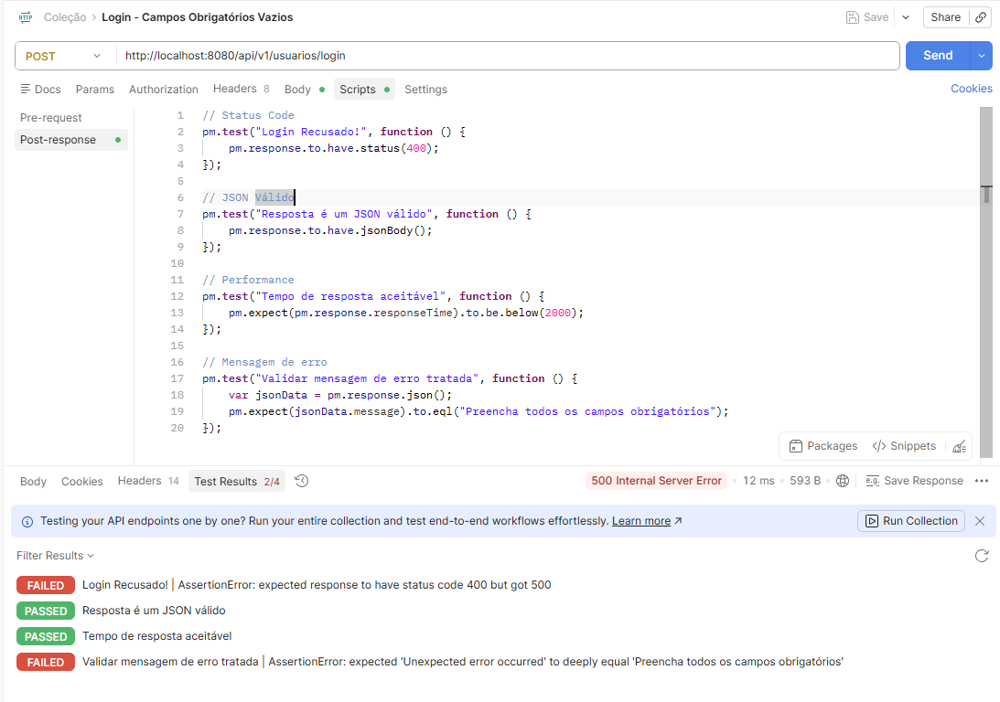
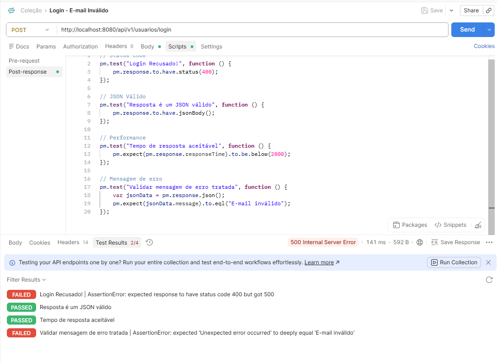
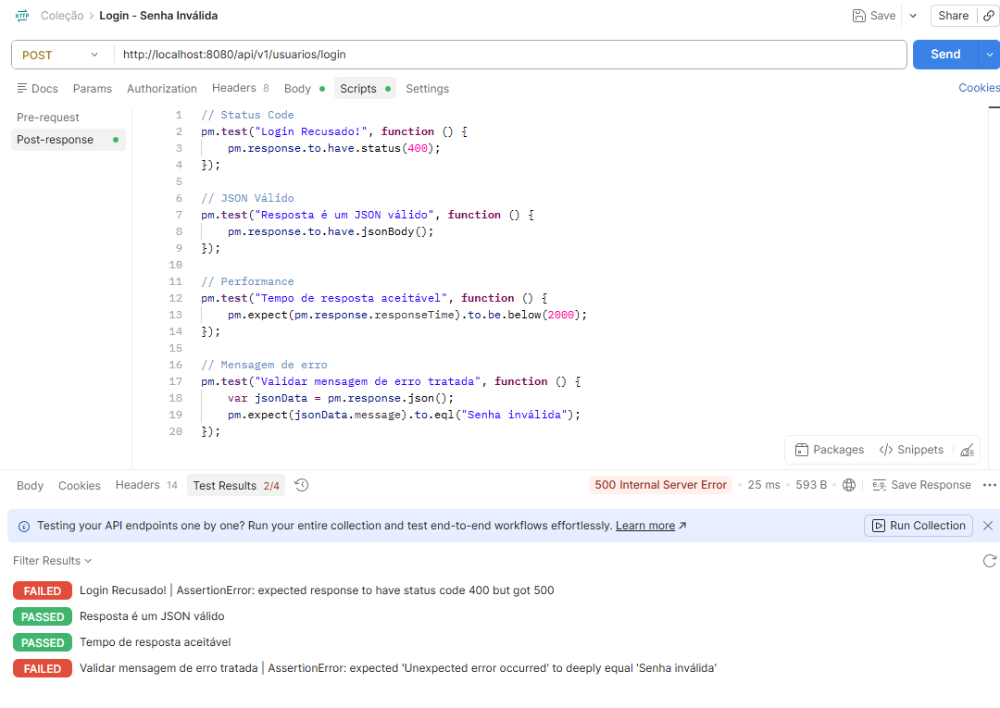
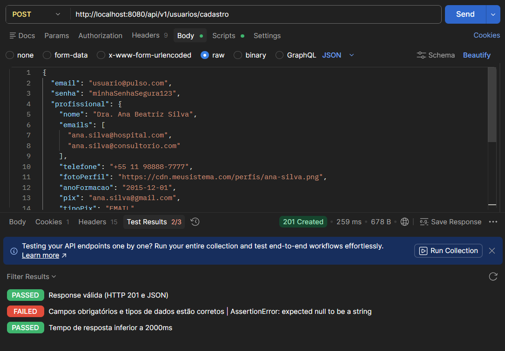
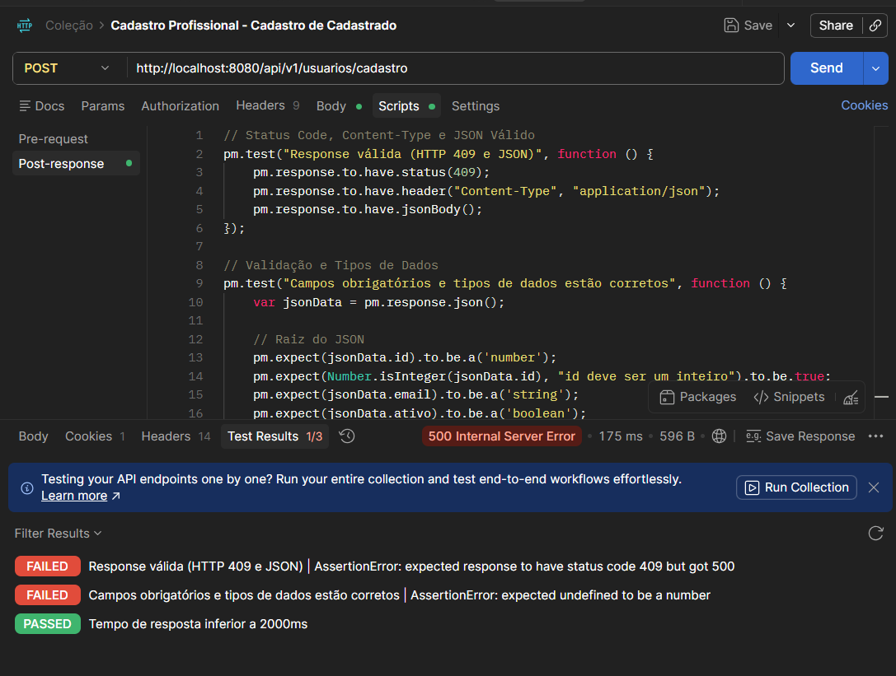
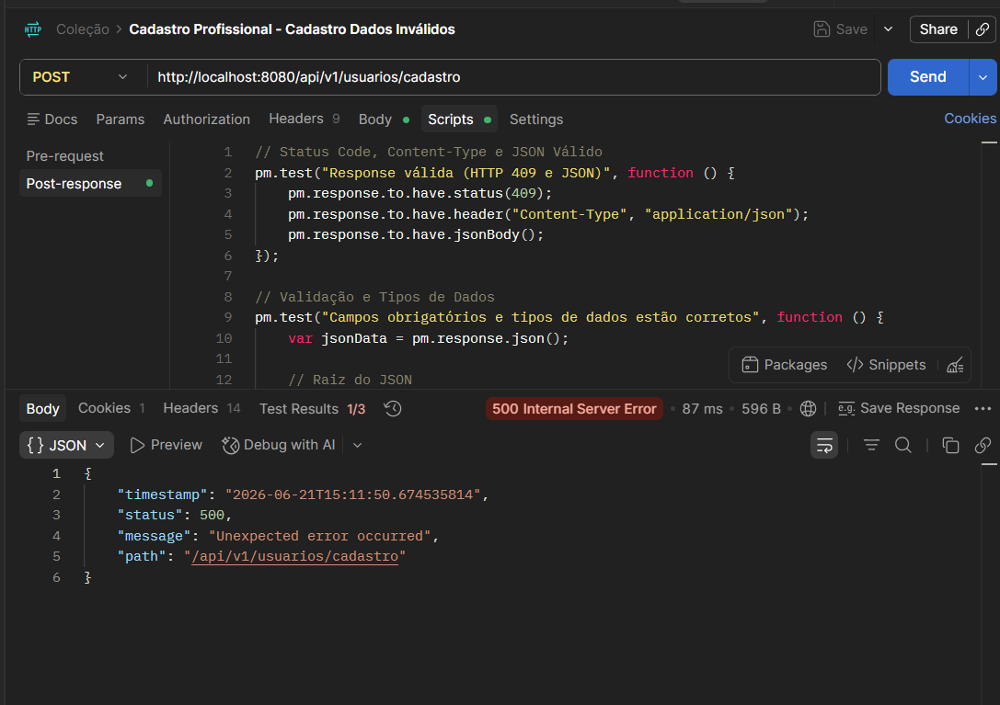

# Testes de API - Autenticação
Desenvolvido por: [Gustavo Maia](https://github.com/gusttavokr)

## Introdução

Este documento reúne os testes de API elaborados para validar os principais fluxos da aplicação Pulso, desenvolvido no contexto do PDS. Os testes aqui descritos abrangem diferentes casos de uso da aplicação, com o objetivo de assegurar que cada funcionalidade opere conforme os requisitos definidos.

Cada teste inclui informações detalhadas sobre o endpoint, o corpo da requisição e o teste em si.

## CDU 01 - Autenticação

### Objetivo
O objetivo do fluxo de autenticação é validar a identidade do usuário de forma segura e eficiente, garantindo que apenas usuários cadastrados tenham acesso a plataforma e áreas restritas, funcionalidades ou dados confidenciais. Além disso, permitir que novos usuários, seja profissional ou instituição, possa acessar a plataforma via cadastro.

### Fluxo Principal - Login

#### Teste API 01 - Login com Credenciais Válidas

##### Objetivo do Teste

Validar que um usuário previamente cadastrado consegue realizar autenticação na plataforma utilizando credenciais válidas.

##### Informações da Requisição

| Campo        | Valor                 |
| ------------ | --------------------- |
| Método HTTP  | POST                  |
| Endpoint     | `/api/v1/usuarios/login/`    |
| Autenticação | Não                   |
| Caso de Uso  | CDU 01 - Autenticação |

##### Cabeçalhos da Requisição

```http
Content-Type: application/json
```

##### Corpo da Requisição

```json
{
  "email": "lider1@pulso.dev",
  "senha": "senha123"
}
```

##### Resposta Esperada

**Status Code:** `200 OK`

```json
{
  "id": 1,
  "token": <token>,
  "tipo": "PROFISSIONAL",
  "roles": [
    "PROFISSIONAL",
    "LIDER_ESCALA"
  ],
  "instituicao": null,
  "profissional": {
    "id": 1,
    "nome": "Lucas Almeida",
    "fotoPerfil": "https://cdn.pixabay.com/photo/2018/03/17/12/12/portrait-3233851_1280.jpg",
    "especialidades": [
      "ANESTESIOLOGIA",
      "CLINICA_GERAL"
    ]
  }
}
```

##### Validações Realizadas

| Validação           | Descrição                            |
| ------------------- | ------------------------------------ |
| Status Code         | Verificar retorno HTTP 200           |
| Campos Obrigatórios | Verificar presença dos tokens        |
| Content-Type        | Verificar retorno JSON               |
| JSON Válido         | Validar estrutura da resposta        |
| Dados Específicos   | Validar existência do token JWT      |
| Performance         | Tempo de resposta inferior a 2000 ms |

##### Script de Teste (Postman)

```javascript
// Status Code
pm.test("Login Efetuado com Sucesso!", function () {
    pm.response.to.have.status(200);
});

// Campos Obrigatórios
pm.test("Resposta contém campos obrigatórios", function () {
    var jsonData = pm.response.json();
    pm.expect(jsonData.profissional.nome).to.exist;
    pm.expect(jsonData.token).to.exist;
});

// JSON Válido
pm.test("Resposta é um JSON válido", function () {
    pm.response.to.have.jsonBody();
});

// Token JWT válido
pm.test("O token retornado possui a estrutura de um JWT válido", function () {
    var jsonData = pm.response.json();
    var jwtRegex = /^[A-Za-z0-9-_=]+\.[A-Za-z0-9-_=]+\.[A-Za-z0-9-_.+/=]*$/;
    pm.expect(jwtRegex.test(jsonData.token)).to.be.true;
});

// Validação de Dados Específicos
pm.test("Campos com tipos corretos", function () {
    var jsonData = pm.response.json();
    pm.expect(jsonData.profissional.nome).to.be.a('string');
    pm.expect(jsonData.token).to.be.a('string');
});

// Performance
pm.test("Tempo de resposta aceitável", function () {
    pm.expect(pm.response.responseTime).to.be.below(2000);
});
```

##### Resultado Obtido

| Item                  | Resultado |
| --------------------- | --------- |
| Status Code           | PASSED    |
| Estrutura da Resposta | PASSED    |
| Performance           | PASSED    |
| Segurança             | PASSED    |

##### Evidências



#### Teste API 02 - Login com Credenciais Vazias

##### Objetivo do Teste

Validar o teste em que um usuário faça login com credenciais vazias.

##### Informações da Requisição

| Campo        | Valor                 |
| ------------ | --------------------- |
| Método HTTP  | POST                  |
| Endpoint     | `/api/v1/usuarios/login/`    |
| Autenticação | Não                   |
| Caso de Uso  | CDU 01 - Autenticação |

##### Cabeçalhos da Requisição

```http
Content-Type: application/json
```

##### Corpo da Requisição

```json
{ }
```

##### Resposta Esperada

**Status Code:** `400 OK`

```json
{
  "timestamp": "2026-06-18T09:46:50.041264916",
  "status": 400,
  "message": "Preencha todos os campos obrigatórios",
  "path": "/api/v1/usuarios/login"
}
```

##### Validações Realizadas

| Validação           | Descrição                            |
| ------------------- | ------------------------------------ |
| Status Code         | Verificar retorno HTTP 400           |
| JSON Válido         | Validar estrutura da resposta        |
| Performance         | Tempo de resposta inferior a 2000 ms |

##### Script de Teste (Postman)

```javascript
// Status Code
pm.test("Login Recusado!", function () {
    pm.response.to.have.status(400);
});

// JSON Válido
pm.test("Resposta é um JSON válido", function () {
    pm.response.to.have.jsonBody();
});

// Performance
pm.test("Tempo de resposta aceitável", function () {
    pm.expect(pm.response.responseTime).to.be.below(2000);
});

// Mensagem de erro
pm.test("Validar mensagem de erro tratada", function () {
    var jsonData = pm.response.json();
    pm.expect(jsonData.message).to.eql("Preencha todos os campos obrigatórios");
});
```

##### Resultado Obtido

| Item                  | Resultado |
| --------------------- | --------- |
| Status Code           | FAILED    |
| Estrutura da Resposta | PASSED    |
| Performance           | PASSED    |
| Mensagem de erro      | FAILED    |

##### Evidências



#### Teste API 03 - Login com E-mail Inválido

##### Objetivo do Teste

Validar o teste em que um usuário faça login com e-mail inválido.

##### Informações da Requisição

| Campo        | Valor                 |
| ------------ | --------------------- |
| Método HTTP  | POST                  |
| Endpoint     | `/api/v1/usuarios/login/`    |
| Autenticação | Não                   |
| Caso de Uso  | CDU 01 - Autenticação |

##### Cabeçalhos da Requisição

```http
Content-Type: application/json
```

##### Corpo da Requisição

```json
{
  "email": "12345",
  "senha": "senha123"
}
```

##### Resposta Esperada

**Status Code:** `400 OK`

```json
{
  "timestamp": "2026-06-18T10:13:09.87216721",
  "status": 400,
  "message": "E-mail inválido",
  "path": "/api/v1/usuarios/login"
}
```

##### Validações Realizadas

| Validação           | Descrição                            |
| ------------------- | ------------------------------------ |
| Status Code         | Verificar retorno HTTP 400           |
| JSON Válido         | Validar estrutura da resposta        |
| Mensagem de erro    | Validar mensagem de erro             |
| Performance         | Tempo de resposta inferior a 2000 ms |

##### Script de Teste (Postman)

```javascript
// Status Code
pm.test("Login Recusado!", function () {
    pm.response.to.have.status(400);
});

// JSON Válido
pm.test("Resposta é um JSON válido", function () {
    pm.response.to.have.jsonBody();
});

// Performance
pm.test("Tempo de resposta aceitável", function () {
    pm.expect(pm.response.responseTime).to.be.below(2000);
});

// Mensagem de erro
pm.test("Validar mensagem de erro tratada", function () {
    var jsonData = pm.response.json();
    pm.expect(jsonData.message).to.eql("E-mail inválido");
});

```

##### Resultado Obtido

| Item                  | Resultado |
| --------------------- | --------- |
| Status Code           | FAILED    |
| Estrutura da Resposta | PASSED    |
| Performance           | PASSED    |
| Mensagem de erro      | FAILED    |

##### Evidências



#### Teste API 04 - Login com Senha Inválida

##### Objetivo do Teste

Validar o teste em que um usuário faça login com a senha em formato inválido.

##### Informações da Requisição

| Campo        | Valor                 |
| ------------ | --------------------- |
| Método HTTP  | POST                  |
| Endpoint     | `/api/v1/usuarios/login/`    |
| Autenticação | Não                   |
| Caso de Uso  | CDU 01 - Autenticação |

##### Cabeçalhos da Requisição

```http
Content-Type: application/json
```

##### Corpo da Requisição

```json
{
  "email": "12345",
  "senha": 250.2
}
```

##### Resposta Esperada

**Status Code:** `400 OK`

```json
{
  "timestamp": "2026-06-18T10:13:09.87216721",
  "status": 400,
  "message": "Senha inválida",
  "path": "/api/v1/usuarios/login"
}
```

##### Validações Realizadas

| Validação           | Descrição                            |
| ------------------- | ------------------------------------ |
| Status Code         | Verificar retorno HTTP 400           |
| JSON Válido         | Validar estrutura da resposta        |
| Mensagem de erro    | Validar mensagem de erro             |
| Performance         | Tempo de resposta inferior a 2000 ms |

##### Script de Teste (Postman)

```javascript
// Status Code
pm.test("Login Recusado!", function () {
    pm.response.to.have.status(400);
});

// JSON Válido
pm.test("Resposta é um JSON válido", function () {
    pm.response.to.have.jsonBody();
});

// Performance
pm.test("Tempo de resposta aceitável", function () {
    pm.expect(pm.response.responseTime).to.be.below(2000);
});

// Mensagem de erro
pm.test("Validar mensagem de erro tratada", function () {
    var jsonData = pm.response.json();
    pm.expect(jsonData.message).to.eql("Senha inválida");
});
```

##### Resultado Obtido

| Item                  | Resultado |
| --------------------- | --------- |
| Status Code           | FAILED    |
| Estrutura da Resposta | PASSED    |
| Performance           | PASSED    |
| Mensagem de erro      | FAILED    |

##### Evidências



### Fluxo Secundário - Cadastro Profissional

#### Teste API 01 - Cadastro Válido

##### Objetivo do Teste

Teste de cenário em que o cadastro de um usuário foi efetuado com sucesso.

##### Informações da Requisição

| Campo        | Valor                 |
| ------------ | --------------------- |
| Método HTTP  | POST                  |
| Endpoint     | `/api/v1/usuarios/cadastro/`    |
| Autenticação | Não                   |
| Caso de Uso  | CDU 01 - Autenticação |

##### Cabeçalhos da Requisição

```http
Content-Type: application/json
```

##### Corpo da Requisição

```json
{
  "email": "usuario@pulso.com",
  "senha": "minhaSenhaSegura123",
  "profissional": {
    "nome": "Dra. Ana Beatriz Silva",
    "emails": [
      "ana.silva@hospital.com",
      "ana.silva@consultorio.com"
    ],
    "telefone": "+55 11 98888-7777",
    "fotoPerfil": "https://cdn.meusistema.com/perfis/ana-silva.png",
    "anoFormacao": "2015-12-01",
    "pix": "ana.silva@gmail.com",
    "tipoPix": "EMAIL",
    "crmNumero": "12345",
    "crms": [
      "SP",
      "RJ"
    ],
    "dataNasc": "1990-04-12",
    "especialidades": [
      "CARDIOLOGIA",
      "CLINICA_GERAL"
    ]
  }
}
```

##### Resposta Esperada

**Status Code:** `201 Created`

```json
{
  "id": 9007199254740991,
  "email": "string",
  "ativo": true,
  "ultimoLogin": "2026-06-21T17:46:02.775Z",
  "criadoEm": "2026-06-21T17:46:02.775Z",
  "atualizadoEm": "2026-06-21T17:46:02.775Z",
  "instituicao": {
    "id": 9007199254740991,
    "nome": "string",
    "emails": [
      "string"
    ],
    "endereco": "string",
    "cnpj": "string"
  },
  "profissional": {
    "id": 9007199254740991,
    "foto": "string",
    "nome": "string"
  }
}
```

##### Validações Realizadas

| Validação           | Descrição                            |
| ------------------- | ------------------------------------ |
| Status Code         | Verificar retorno HTTP 201           |
| Campos Obrigatórios | Verificar presença dos tokens        |
| Content-Type        | Verificar retorno JSON               |
| JSON Válido         | Validar estrutura da resposta        |
| Performance         | Tempo de resposta inferior a 2000 ms |

##### Script de Teste (Postman)

```javascript
// Status Code, Content-Type e JSON Válido
pm.test("Response válida (HTTP 201 e JSON)", function () {
    pm.response.to.have.status(201);
    pm.response.to.have.header("Content-Type", "application/json");
    pm.response.to.have.jsonBody();
});

// Validação e Tipos de Dados
pm.test("Campos obrigatórios e tipos de dados estão corretos", function () {
    var jsonData = pm.response.json();
    
    // Raiz do JSON
    pm.expect(jsonData.id).to.be.a('number');
    pm.expect(Number.isInteger(jsonData.id), "id deve ser um inteiro").to.be.true;
    pm.expect(jsonData.email).to.be.a('string');
    pm.expect(jsonData.ativo).to.be.a('boolean');
    pm.expect(jsonData.ultimoLogin).to.be.a('string');
    pm.expect(jsonData.criadoEm).to.be.a('string');
    pm.expect(jsonData.atualizadoEm).to.be.a('string');

    // Objeto Instituição
    pm.expect(jsonData.instituicao).to.be.a('object');
    pm.expect(jsonData.instituicao.id).to.be.a('number');
    pm.expect(jsonData.instituicao.nome).to.be.a('string');
    pm.expect(jsonData.instituicao.emails).to.be.an('array');
    pm.expect(jsonData.instituicao.emails[0]).to.be.a('string');
    pm.expect(jsonData.instituicao.endereco).to.be.a('string');
    pm.expect(jsonData.instituicao.cnpj).to.be.a('string');

    // Objeto Profissional
    pm.expect(jsonData.profissional).to.be.a('object');
    pm.expect(jsonData.profissional.id).to.be.a('number');
    pm.expect(jsonData.profissional.foto).to.be.a('string');
    pm.expect(jsonData.profissional.nome).to.be.a('string');
});

// Performance
pm.test("Tempo de resposta inferior a 2000ms", function () {
    pm.expect(pm.response.responseTime).to.be.below(2000);
});
```

##### Resultado Obtido

| Item                  | Resultado |
| --------------------- | --------- |
| Status Code           | PASSED    |
| Campos Obrigatórios   | FAILED    |
| Performance           | PASSED    |

##### Evidências


#### Teste API 02 - Usuário já Cadastrado

##### Objetivo do Teste

Cadastro de um usuário que já foi cadastrado.

##### Informações da Requisição

| Campo        | Valor                 |
| ------------ | --------------------- |
| Método HTTP  | POST                  |
| Endpoint     | `/api/v1/usuarios/cadastro/`    |
| Autenticação | Não                   |
| Caso de Uso  | CDU 01 - Autenticação |

##### Cabeçalhos da Requisição

```http
Content-Type: application/json
```

##### Corpo da Requisição

```json
{
  "email": "usuario@pulso.com",
  "senha": "minhaSenhaSegura123",
  "profissional": {
    "nome": "Dra. Ana Beatriz Silva",
    "emails": [
      "ana.silva@hospital.com",
      "ana.silva@consultorio.com"
    ],
    "telefone": "+55 11 98888-7777",
    "fotoPerfil": "https://cdn.meusistema.com/perfis/ana-silva.png",
    "anoFormacao": "2015-12-01",
    "pix": "ana.silva@gmail.com",
    "tipoPix": "EMAIL",
    "crmNumero": "12345",
    "crms": [
      "SP",
      "RJ"
    ],
    "dataNasc": "1990-04-12",
    "especialidades": [
      "CARDIOLOGIA",
      "CLINICA_GERAL"
    ]
  }
}
```

##### Resposta Esperada

**Status Code:** `409`

```json
{
  "id": 9007199254740991,
  "email": "string",
  "ativo": true,
  "ultimoLogin": "2026-06-21T17:59:34.286Z",
  "criadoEm": "2026-06-21T17:59:34.286Z",
  "atualizadoEm": "2026-06-21T17:59:34.286Z",
  "instituicao": {
    "id": 9007199254740991,
    "nome": "string",
    "emails": [
      "string"
    ],
    "endereco": "string",
    "cnpj": "string"
  },
  "profissional": {
    "id": 9007199254740991,
    "foto": "string",
    "nome": "string"
  }
}
```

##### Validações Realizadas

| Validação           | Descrição                            |
| ------------------- | ------------------------------------ |
| Status Code         | Verificar retorno HTTP 409           |
| Campos Obrigatórios | Verificar presença dos tokens        |
| Content-Type        | Verificar retorno JSON               |
| JSON Válido         | Validar estrutura da resposta        |
| Performance         | Tempo de resposta inferior a 2000 ms |

##### Script de Teste (Postman)

```javascript
// Status Code, Content-Type e JSON Válido
pm.test("Response válida (HTTP 201 e JSON)", function () {
    pm.response.to.have.status(409);
    pm.response.to.have.header("Content-Type", "application/json");
    pm.response.to.have.jsonBody();
});

// Validação e Tipos de Dados
pm.test("Campos obrigatórios e tipos de dados estão corretos", function () {
    var jsonData = pm.response.json();
    
    // Raiz do JSON
    pm.expect(jsonData.id).to.be.a('number');
    pm.expect(Number.isInteger(jsonData.id), "id deve ser um inteiro").to.be.true;
    pm.expect(jsonData.email).to.be.a('string');
    pm.expect(jsonData.ativo).to.be.a('boolean');
    pm.expect(jsonData.ultimoLogin).to.be.a('string');
    pm.expect(jsonData.criadoEm).to.be.a('string');
    pm.expect(jsonData.atualizadoEm).to.be.a('string');

    // Objeto Instituição
    pm.expect(jsonData.instituicao).to.be.a('object');
    pm.expect(jsonData.instituicao.id).to.be.a('number');
    pm.expect(jsonData.instituicao.nome).to.be.a('string');
    pm.expect(jsonData.instituicao.emails).to.be.an('array');
    pm.expect(jsonData.instituicao.emails[0]).to.be.a('string');
    pm.expect(jsonData.instituicao.endereco).to.be.a('string');
    pm.expect(jsonData.instituicao.cnpj).to.be.a('string');

    // Objeto Profissional
    pm.expect(jsonData.profissional).to.be.a('object');
    pm.expect(jsonData.profissional.id).to.be.a('number');
    pm.expect(jsonData.profissional.foto).to.be.a('string');
    pm.expect(jsonData.profissional.nome).to.be.a('string');
});

// Performance
pm.test("Tempo de resposta inferior a 2000ms", function () {
    pm.expect(pm.response.responseTime).to.be.below(2000);
});
```

##### Resultado Obtido

| Item                  | Resultado |
| --------------------- | --------- |
| Status Code           | FAILED    |
| Campos Obrigatórios   | FAILED    |
| Performance           | PASSED    |

##### Evidências


#### Teste API 03 - Cadastro com Dados Inválidos

##### Objetivo do Teste

Cadastro de um usuário com dados inválidos.

##### Informações da Requisição

| Campo        | Valor                 |
| ------------ | --------------------- |
| Método HTTP  | POST                  |
| Endpoint     | `/api/v1/usuarios/cadastro/`    |
| Autenticação | Não                   |
| Caso de Uso  | CDU 01 - Autenticação |

##### Cabeçalhos da Requisição

```http
Content-Type: application/json
```

##### Corpo da Requisição

```json
{
  "email": 100000000,
  "senha": "minhaSenhaSegura123",
  "profissional": {
    "nome": "Dra. Ana Beatriz Silva",
    "emails": [
      "ana.silva@hospital.com",
      "ana.silva@consultorio.com"
    ],
    "telefone": "+55 11 98888-7777",
    "fotoPerfil": "https://cdn.meusistema.com/perfis/ana-silva.png",
    "anoFormacao": "2015-12-01",
    "pix": "ana.silva@gmail.com",
    "tipoPix": "EMAIL",
    "crmNumero": "12345",
    "crms": [
      "SP",
      "RJ"
    ],
    "dataNasc": "1990-04-12",
    "especialidades": [
      "CARDIOLOGIA",
      "CLINICA_GERAL"
    ]
  }
}
```

##### Resposta Esperada

**Status Code:** `400 Bad Request`

```json
{
  "id": 9007199254740991,
  "email": "string",
  "ativo": true,
  "ultimoLogin": "2026-06-21T18:10:30.889Z",
  "criadoEm": "2026-06-21T18:10:30.889Z",
  "atualizadoEm": "2026-06-21T18:10:30.889Z",
  "instituicao": {
    "id": 9007199254740991,
    "nome": "string",
    "emails": [
      "string"
    ],
    "endereco": "string",
    "cnpj": "string"
  },
  "profissional": {
    "id": 9007199254740991,
    "foto": "string",
    "nome": "string"
  }
}
```

##### Validações Realizadas

| Validação           | Descrição                            |
| ------------------- | ------------------------------------ |
| Status Code         | Verificar retorno HTTP 400           |
| Campos Obrigatórios | Verificar presença dos tokens        |
| Content-Type        | Verificar retorno JSON               |
| JSON Válido         | Validar estrutura da resposta        |
| Performance         | Tempo de resposta inferior a 2000 ms |

##### Script de Teste (Postman)

```javascript
// Status Code, Content-Type e JSON Válido
pm.test("Response válida (HTTP 400 e JSON)", function () {
    pm.response.to.have.status(400);
    pm.response.to.have.header("Content-Type", "application/json");
    pm.response.to.have.jsonBody();
});

// Validação e Tipos de Dados
pm.test("Campos obrigatórios e tipos de dados estão corretos", function () {
    var jsonData = pm.response.json();
    
    // Raiz do JSON
    pm.expect(jsonData.id).to.be.a('number');
    pm.expect(Number.isInteger(jsonData.id), "id deve ser um inteiro").to.be.true;
    pm.expect(jsonData.email).to.be.a('string');
    pm.expect(jsonData.ativo).to.be.a('boolean');
    pm.expect(jsonData.ultimoLogin).to.be.a('string');
    pm.expect(jsonData.criadoEm).to.be.a('string');
    pm.expect(jsonData.atualizadoEm).to.be.a('string');

    // Objeto Instituição
    pm.expect(jsonData.instituicao).to.be.a('object');
    pm.expect(jsonData.instituicao.id).to.be.a('number');
    pm.expect(jsonData.instituicao.nome).to.be.a('string');
    pm.expect(jsonData.instituicao.emails).to.be.an('array');
    pm.expect(jsonData.instituicao.emails[0]).to.be.a('string');
    pm.expect(jsonData.instituicao.endereco).to.be.a('string');
    pm.expect(jsonData.instituicao.cnpj).to.be.a('string');

    // Objeto Profissional
    pm.expect(jsonData.profissional).to.be.a('object');
    pm.expect(jsonData.profissional.id).to.be.a('number');
    pm.expect(jsonData.profissional.foto).to.be.a('string');
    pm.expect(jsonData.profissional.nome).to.be.a('string');
});

// Performance
pm.test("Tempo de resposta inferior a 2000ms", function () {
    pm.expect(pm.response.responseTime).to.be.below(2000);
});
```

##### Resultado Obtido

| Item                  | Resultado |
| --------------------- | --------- |
| Status Code           | FAILED    |
| Campos Obrigatórios   | FAILED    |
| Performance           | PASSED    |

##### Evidências
