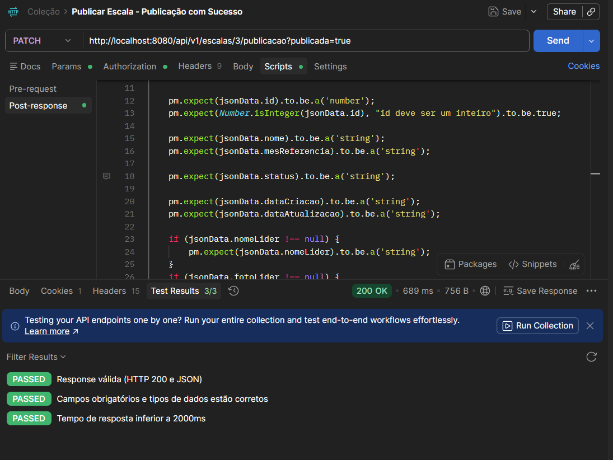
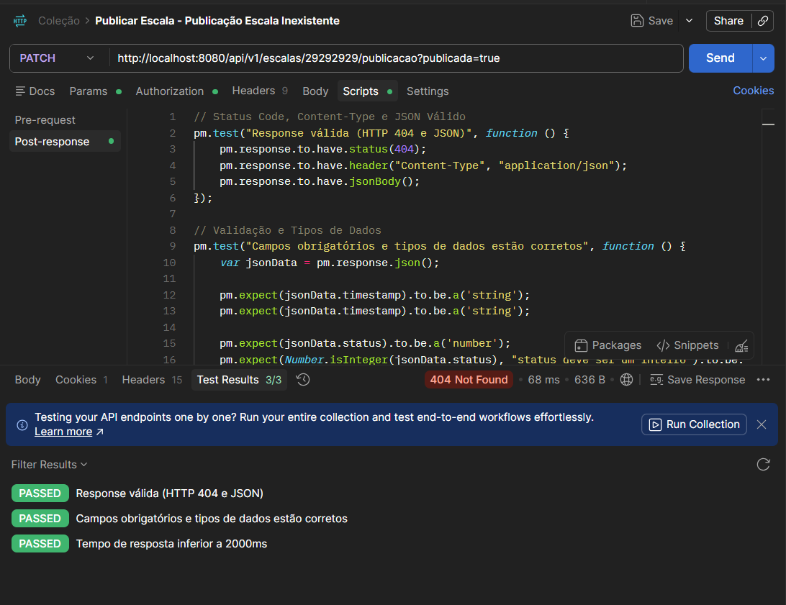
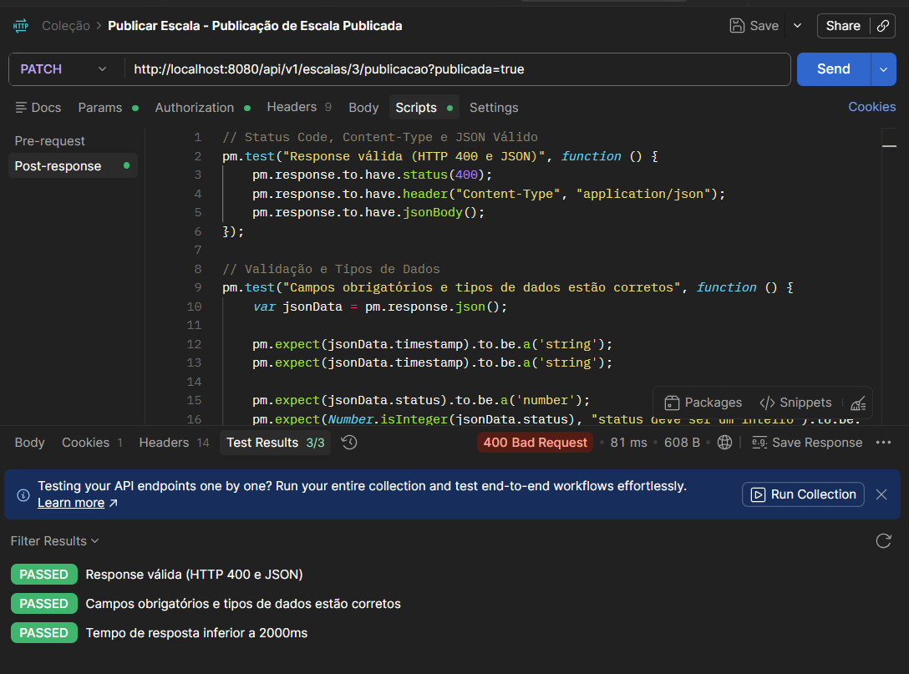
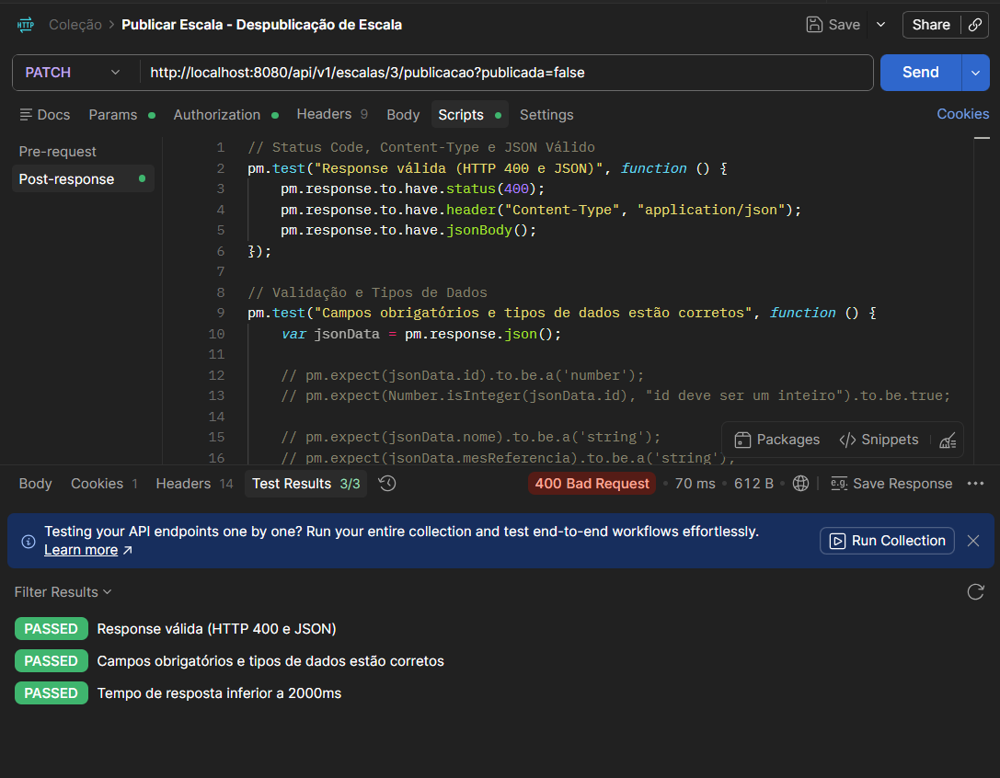

# Testes de API - Publicar Escala
Desenvolvido por: [Gustavo Maia](https://github.com/gusttavokr)

## Introdução

Este documento reúne os testes de API elaborados para validar os principais fluxos da aplicação Pulso, desenvolvido no contexto do PDS. Os testes aqui descritos abrangem diferentes casos de uso da aplicação, com o objetivo de assegurar que cada funcionalidade opere conforme os requisitos definidos.

Cada teste inclui informações detalhadas sobre o endpoint, o corpo da requisição e o teste em si.

## CDU 04 - Publicar Escala

### Objetivo
O objetivo do fluxo de Publicar Escala é validar o comportamento do sistema com relação a divulgação das escalas publicadas pelo Líder de Escala, de forma segura e eficiente. Garantindo que as escalas sejam compartilhadas com os profissionais assim atribuídos.

### Fluxo Principal

#### 1. Autenticação (Pré-requisito)
**Método:** POST  
**URL:** `/api/v1/auth/login`  
**Corpo da Requisição (JSON):**
```json
{
  "email": "lider1@pulso.dev",
  "senha": "senha123"
}
```
*Gere o Bearer Token para usar na próxima requisição.*

---

#### 2. Publicação de Escala
**Método:** PATCH  
**URL:** `/api/v1/escalas/{id}/publicacao`  
**Headers:** `Authorization: Bearer <seu_token>`  
**Query Params:** `publicada=true` (ou false)  
**Corpo da Requisição:** *Não possui corpo (Vazio).*

#### Teste API 01 - Publicação com Sucesso

##### Objetivo do Teste

O objetivo desse teste é validar o cenário em que um usuário previamente autenticado, consiga publicar uma escala com êxito.

##### Informações da Requisição

| Campo        | Valor                 |
| ------------ | --------------------- |
| Método HTTP  | POST                  |
| Endpoint     | `/api/v1/escalas/{id}/publicacao` |
| Autenticação | Bearer Token          |
| Caso de Uso  | CDU 04 - Publicar Escala |

##### Cabeçalhos da Requisição

```http
Content-Type: application/json
```

##### Resposta Esperada

**Status Code:** `200 OK`

```json
{
    "id": 1,
    "nome": "Escala Emergência - Março/2026",
    "mesReferencia": "2026-08-01",
    "status": "PUBLICADA",
    "dataCriacao": "2026-06-18T13:46:02.766522",
    "dataAtualizacao": "2026-06-18T13:46:02.766522",
    "nomeLider": "Lucas Almeida",
    "fotoLider": "https://cdn.pixabay.com/photo/2018/03/17/12/12/portrait-3233851_1280.jpg"
}
```

##### Validações Realizadas

| Validação           | Descrição                            |
| ------------------- | ------------------------------------ |
| Status Code         | Verificar retorno HTTP 200           |
| Campos Obrigatórios | Verificar presença dos tokens        |
| Content-Type        | Verificar retorno JSON               |
| JSON Válido         | Validar estrutura da resposta        |
| Dados Específicos   | Tipos dos dados necessários          |
| Performance         | Tempo de resposta inferior a 2000 ms |

##### Script de Teste (Postman)

```javascript
// Status Code, Content-Type e JSON Válido
pm.test("Response válida (HTTP 200 e JSON)", function () {
    pm.response.to.have.status(200);
    pm.response.to.have.header("Content-Type", "application/json");
    pm.response.to.have.jsonBody();
});

// Validação e Tipos de Dados
pm.test("Campos obrigatórios e tipos de dados estão corretos", function () {
    var jsonData = pm.response.json();
    
    pm.expect(jsonData.id).to.be.a('number');
    pm.expect(Number.isInteger(jsonData.id), "id deve ser um inteiro").to.be.true;
    
    pm.expect(jsonData.nome).to.be.a('string');
    pm.expect(jsonData.mesReferencia).to.be.a('string');
    
    pm.expect(jsonData.status).to.be.a('string');

    pm.expect(jsonData.dataCriacao).to.be.a('string');
    pm.expect(jsonData.dataAtualizacao).to.be.a('string');

    if (jsonData.nomeLider !== null) {
        pm.expect(jsonData.nomeLider).to.be.a('string');
    }
    if (jsonData.fotoLider !== null) {
        pm.expect(jsonData.fotoLider).to.be.a('string');
    }
});

// Performance
pm.test("Tempo de resposta inferior a 2000ms", function () {
    pm.expect(pm.response.responseTime).to.be.below(2000);
});
```

##### Resultado Obtido

| Item                  | Resultado |
| --------------------- | --------- |
| Status Code           | PASSED    |
| Estrutura da Resposta | PASSED    |
| Performance           | PASSED    |
| Segurança             | PASSED    |

##### Evidências



#### Teste API 02 - Publicação de Escala Inexistente

##### Objetivo do Teste

O objetivo desse teste é validar o cenário em que um usuário não consiga publicar uma escala que não existe.

##### Informações da Requisição

| Campo        | Valor                 |
| ------------ | --------------------- |
| Método HTTP  | POST                  |
| Endpoint     | `/api/v1/escalas/{id}/publicacao` |
| Autenticação | Bearer Token          |
| Caso de Uso  | CDU 04 - Publicar Escala |

##### Cabeçalhos da Requisição

```http
Content-Type: application/json
```

##### Resposta Esperada

**Status Code:** `404`

```json
{
  "timestamp": "2026-06-20T19:27:34.190242972",
  "status": 404,
  "message": "Escala não encontrada com ID <id>",
  "path": "/api/v1/escalas/<id>/publicacao"
}
```

##### Validações Realizadas

| Validação           | Descrição                            |
| ------------------- | ------------------------------------ |
| Status Code         | Verificar retorno HTTP 404           |
| Campos Obrigatórios | Verificar presença dos tokens        |
| Content-Type        | Verificar retorno JSON               |
| JSON Válido         | Validar estrutura da resposta        |
| Dados Específicos   | Tipos dos dados necessários          |
| Performance         | Tempo de resposta inferior a 2000 ms |

##### Script de Teste (Postman)

```javascript
// Status Code, Content-Type e JSON Válido
pm.test("Response válida (HTTP 404 e JSON)", function () {
    pm.response.to.have.status(404);
    pm.response.to.have.header("Content-Type", "application/json");
    pm.response.to.have.jsonBody();
});

// Validação e Tipos de Dados
pm.test("Campos obrigatórios e tipos de dados estão corretos", function () {
    var jsonData = pm.response.json();
    
    pm.expect(jsonData.timestamp).to.be.a('string');
    pm.expect(jsonData.timestamp).to.be.a('string');

    pm.expect(jsonData.status).to.be.a('number');
    pm.expect(Number.isInteger(jsonData.status), "status deve ser um inteiro").to.be.true;

    pm.expect(jsonData.message).to.be.a('string');
    pm.expect(jsonData.message).to.be.a('string');

    pm.expect(jsonData.path).to.be.a('string');
    pm.expect(jsonData.path).to.be.a('string');
});

// Performance
pm.test("Tempo de resposta inferior a 2000ms", function () {
    pm.expect(pm.response.responseTime).to.be.below(2000);
});
```

##### Resultado Obtido

| Item                  | Resultado |
| --------------------- | --------- |
| Status Code           | PASSED    |
| Estrutura da Resposta | PASSED    |
| Performance           | PASSED    |
| Segurança             | PASSED    |

##### Evidências



#### Teste API 03 - Publicação de Escala Publicada

##### Objetivo do Teste

O objetivo desse teste é validar o cenário em que um usuário não consiga publicar uma escala já publicada.

##### Informações da Requisição

| Campo        | Valor                 |
| ------------ | --------------------- |
| Método HTTP  | POST                  |
| Endpoint     | `/api/v1/escalas/{id}/publicacao` |
| Autenticação | Bearer Token          |
| Caso de Uso  | CDU 04 - Publicar Escala |

##### Cabeçalhos da Requisição

```http
Content-Type: application/json
```

##### Resposta Esperada

**Status Code:** `400`

```json
{
  "timestamp": "2026-06-20T19:36:58.209953166",
  "status": 400,
  "message": "só é possivel publicar escalas em rascunho",
  "path": "/api/v1/escalas/<id>/publicacao"
}
```

##### Validações Realizadas

| Validação           | Descrição                            |
| ------------------- | ------------------------------------ |
| Status Code         | Verificar retorno HTTP 400           |
| Campos Obrigatórios | Verificar presença dos tokens        |
| Content-Type        | Verificar retorno JSON               |
| JSON Válido         | Validar estrutura da resposta        |
| Dados Específicos   | Tipos dos dados necessários          |
| Performance         | Tempo de resposta inferior a 2000 ms |

##### Script de Teste (Postman)

```javascript
// Status Code, Content-Type e JSON Válido
pm.test("Response válida (HTTP 400 e JSON)", function () {
    pm.response.to.have.status(400);
    pm.response.to.have.header("Content-Type", "application/json");
    pm.response.to.have.jsonBody();
});

// Validação e Tipos de Dados
pm.test("Campos obrigatórios e tipos de dados estão corretos", function () {
    var jsonData = pm.response.json();
    
    pm.expect(jsonData.timestamp).to.be.a('string');
    pm.expect(jsonData.timestamp).to.be.a('string');

    pm.expect(jsonData.status).to.be.a('number');
    pm.expect(Number.isInteger(jsonData.status), "status deve ser um inteiro").to.be.true;

    pm.expect(jsonData.message).to.be.a('string');
    pm.expect(jsonData.message).to.be.a('string');

    pm.expect(jsonData.path).to.be.a('string');
    pm.expect(jsonData.path).to.be.a('string');
});

// Performance
pm.test("Tempo de resposta inferior a 2000ms", function () {
    pm.expect(pm.response.responseTime).to.be.below(2000);
});
```

##### Resultado Obtido

| Item                  | Resultado |
| --------------------- | --------- |
| Status Code           | PASSED    |
| Estrutura da Resposta | PASSED    |
| Performance           | PASSED    |
| Segurança             | PASSED    |

##### Evidências



#### Teste API 04 - Despublicação de Escala

##### Objetivo do Teste

O objetivo desse teste é validar o cenário em que um usuário não consiga tornar uma escala já publicada em rascunho novamente.

##### Informações da Requisição

| Campo        | Valor                 |
| ------------ | --------------------- |
| Método HTTP  | POST                  |
| Endpoint     | `/api/v1/escalas/{id}/publicacao` |
| Autenticação | Bearer Token          |
| Caso de Uso  | CDU 04 - Publicar Escala |

##### Cabeçalhos da Requisição

```http
Content-Type: application/json
```

##### Resposta Esperada

**Status Code:** `400`

```json
{
  "timestamp": "2026-06-20T19:42:36.920895149",
  "status": 400,
  "message": "Uma escala publicada não pode ser despublicada.",
  "path": "/api/v1/escalas/3/publicacao"
}
```

##### Validações Realizadas

| Validação           | Descrição                            |
| ------------------- | ------------------------------------ |
| Status Code         | Verificar retorno HTTP 400           |
| Campos Obrigatórios | Verificar presença dos tokens        |
| Content-Type        | Verificar retorno JSON               |
| JSON Válido         | Validar estrutura da resposta        |
| Dados Específicos   | Tipos dos dados necessários          |
| Performance         | Tempo de resposta inferior a 2000 ms |

##### Script de Teste (Postman)

```javascript
// Status Code, Content-Type e JSON Válido
pm.test("Response válida (HTTP 400 e JSON)", function () {
    pm.response.to.have.status(400);
    pm.response.to.have.header("Content-Type", "application/json");
    pm.response.to.have.jsonBody();
});

// Validação e Tipos de Dados
pm.test("Campos obrigatórios e tipos de dados estão corretos", function () {
    var jsonData = pm.response.json();
    
    pm.expect(jsonData.timestamp).to.be.a('string');
    pm.expect(jsonData.timestamp).to.be.a('string');

    pm.expect(jsonData.status).to.be.a('number');
    pm.expect(Number.isInteger(jsonData.status), "status deve ser um inteiro").to.be.true;

    pm.expect(jsonData.message).to.be.a('string');
    pm.expect(jsonData.message).to.be.a('string');

    pm.expect(jsonData.path).to.be.a('string');
    pm.expect(jsonData.path).to.be.a('string');
});

// Performance
pm.test("Tempo de resposta inferior a 2000ms", function () {
    pm.expect(pm.response.responseTime).to.be.below(2000);
});
```

##### Resultado Obtido

| Item                  | Resultado |
| --------------------- | --------- |
| Status Code           | PASSED    |
| Estrutura da Resposta | PASSED    |
| Performance           | PASSED    |
| Segurança             | PASSED    |

##### Evidências


