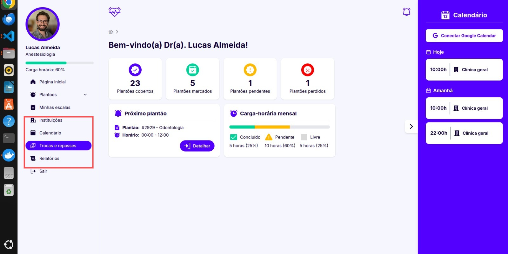
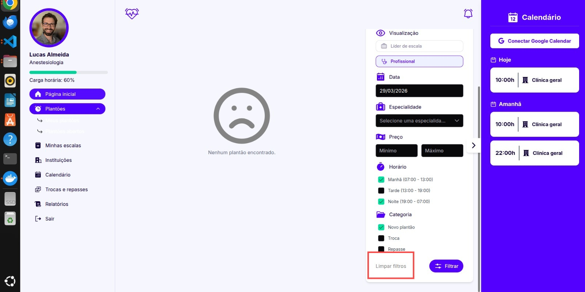
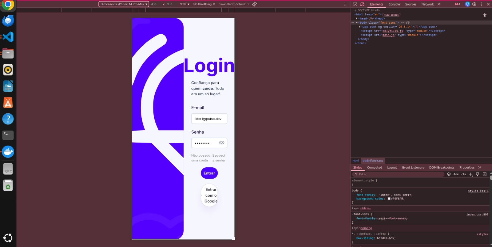
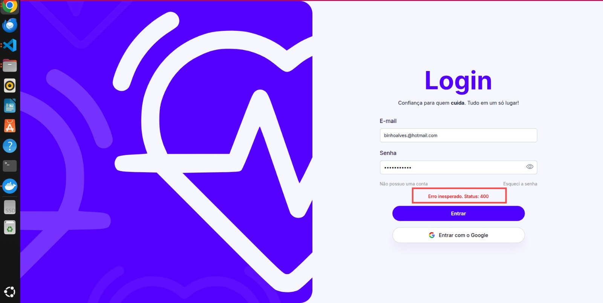
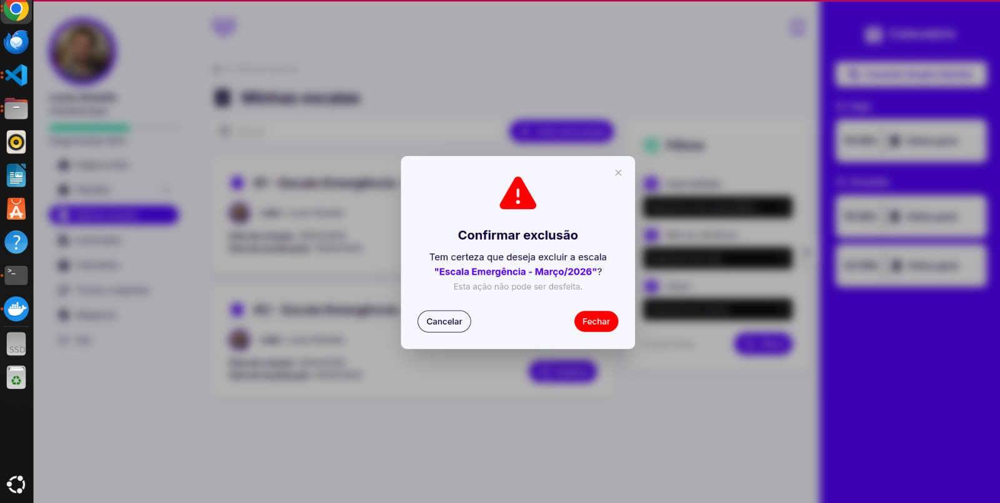
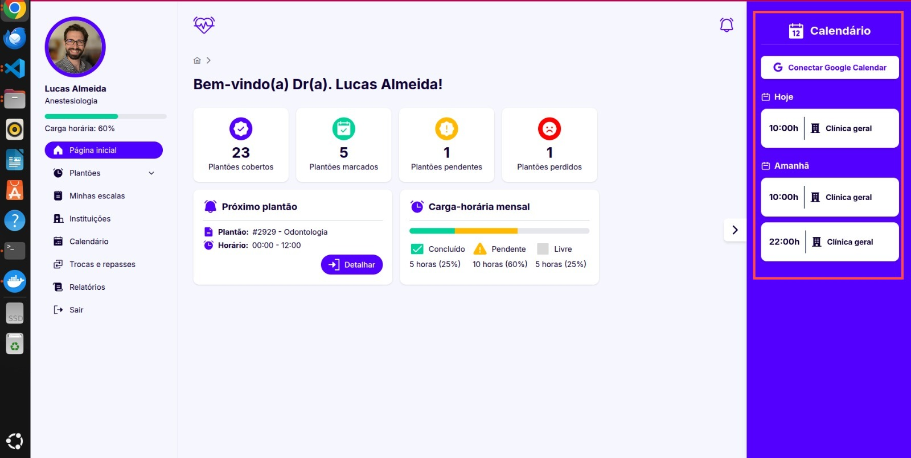
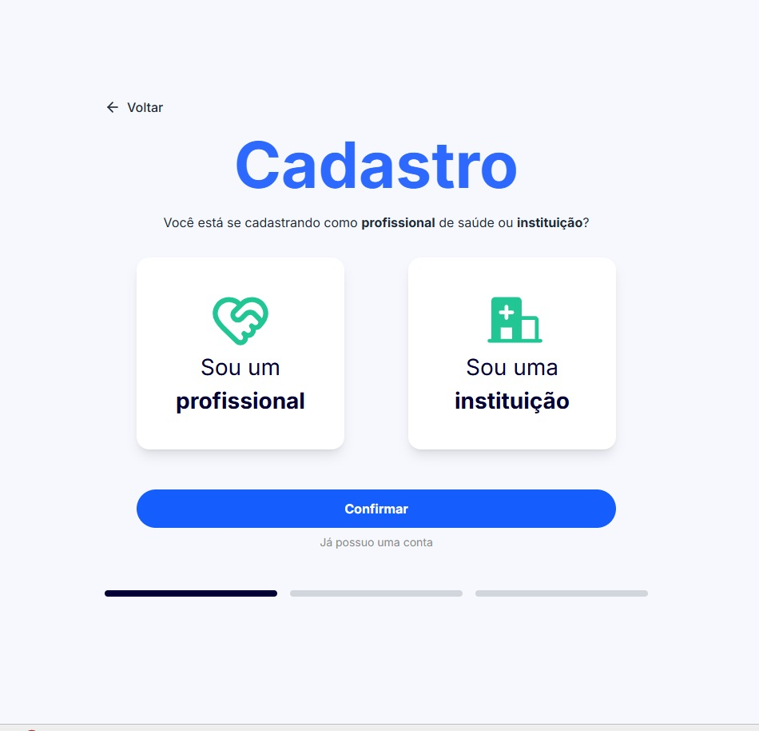
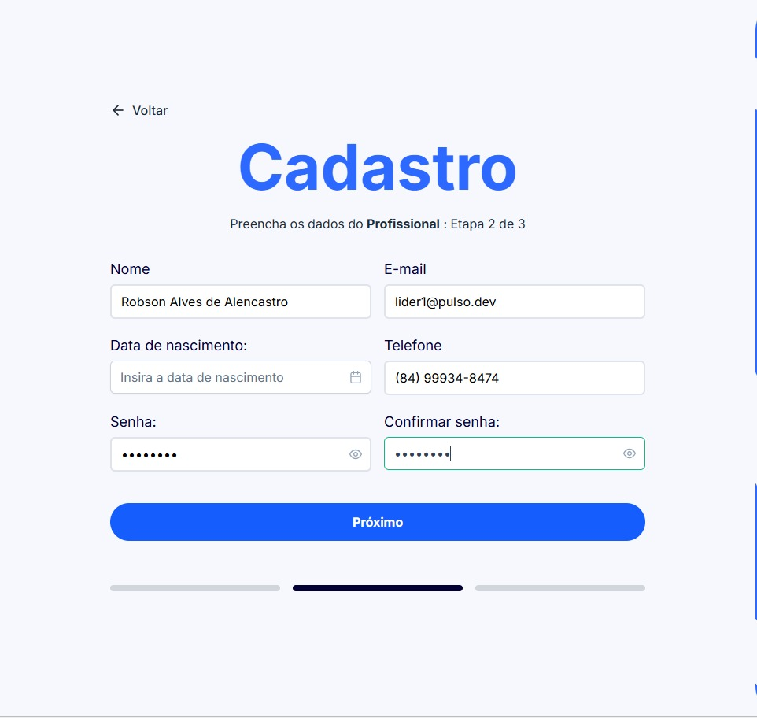
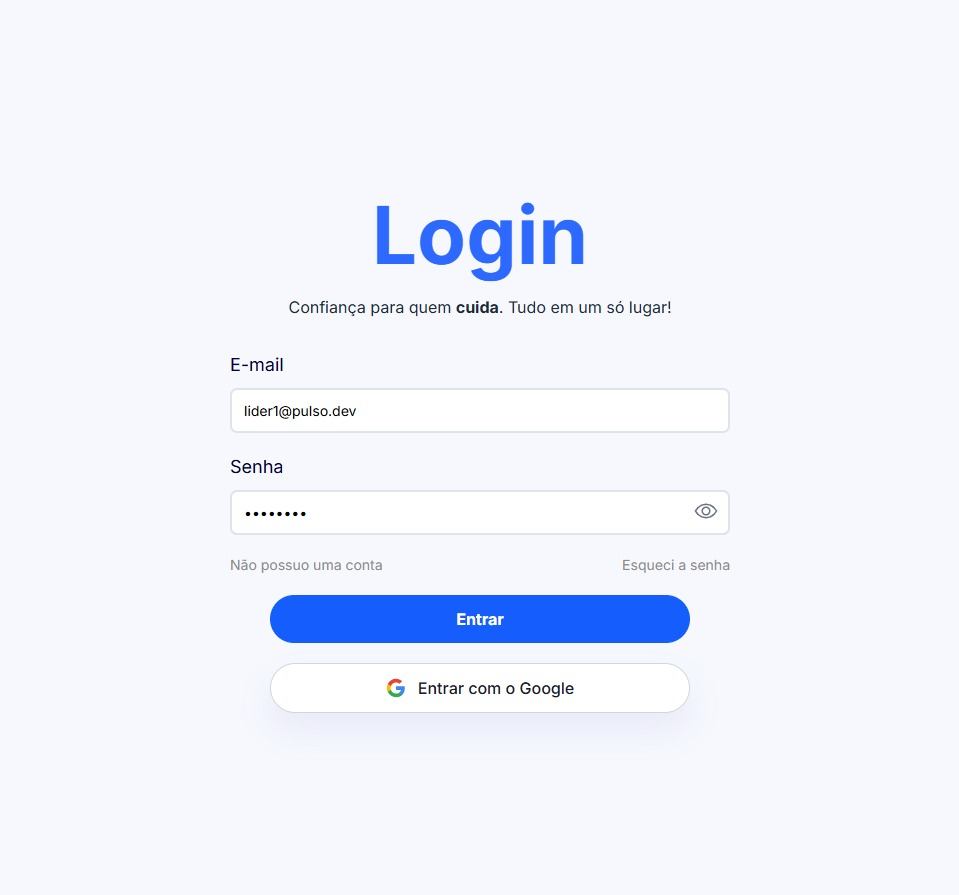

# Avaliação por inspeção com lista Eureca

Este documento apresenta a avaliação individual das interfaces do sistema Pulso, realizada pelo avaliador Robson Alencastro, com base nas heurísticas Eureka (Matos, Freire, Duarte e Vieira, 2025).

Foram analisadas as interfaces relacionadas aos casos de uso: gerenciar escala, gerenciar plantão, alocar profissional em plantão, consultar plantões abertos e pegar plantão.

## CDU 01 - Gerenciar escala

| Nº | Problema | Princípios violados | Sugestão | Gravidade | Esforço |
|----|----------|---------------------|----------|-----------|---------|
| 1 | Alguns itens do menu lateral parecem disponíveis (Instituições, Calendário, Trocas e repasses, Relatórios), mas não levam a fluxos claros. Isso reduz previsibilidade da navegação. Print: [01](prints/01-na2-menu.png) | AF1 - Funcionalidade | Exibir apenas itens com rota funcional por perfil. Se uma área não estiver pronta, ocultar ou sinalizar como "Em desenvolvimento" sem redirecionamento silencioso. | Alta | Moderado |
| 2 | No modal de exclusão de escala, os rótulos dos botões geram dúvida sobre qual ação confirma a exclusão e qual ação cancela. Print: [02](prints/05-af8-exclusao.png) | AF8 - Cancelamento de ações | Diferenciar visualmente e textualmente as ações de cancelar e excluir, mantendo linguagem direta e inequívoca. | Baixa | Leve |
| 3 | Ao criar uma nova escala, não há feedback visual de carregamento (spinner/loader visível). O botão apenas muda o texto para "Criando..." sem indicação clara de progresso ou bloqueio de ações, deixando o usuário incerto sobre o status. | CO2 - Feedback adequado | Adicionar spinner/loader animado ao lado do texto "Criando..." ou desabilitar o botão com mudança visual (opacity, ícone de carregamento). Opcionalmente, mostrar "Criando escala..." em vez de texto genérico. | Baixa | Leve |
| 4 | As listas de escalas (Minhas Escalas) utilizam `max-w-300` com `mr-4` (margem à direita), criando layouts com largura máxima fixa que não se adaptam bem a viewports pequenos ou tablets em orientação retrato. | PD3 - Responsividade | Remover `max-w-300` e usar `max-w-sm` ou `max-w-md` com `md:` breakpoints. Adicionar `flex-wrap` e padding responsivo. Implementar `w-full` ou `w-[calc(100%-1rem)]` em mobile. | Alta | Moderado |
| 5 | Ao editar uma escala existente, não há indicação visual clara de quais campos foram modificados em relação aos dados salvos anteriormente. Todas as alterações parecem ter o mesmo "peso" visual. | EI2 - Edição e input | Destacar visualmente campos editados (ex.: ícone de lápis, fundo amarelado, ou badge "Modificado") para que o usuário saiba exatamente o que mudou antes de salvar. | Baixa | Moderado |
| 6 | O breadcrumb de navegação dentro do fluxo de escalas não possui `aria-current="page"` ou indicação visual clara da página ativa, dificultando a orientação de usuários que usam leitores de tela. | AC2 - Navegação por teclado | Adicionar `aria-current="page"` ao item ativo do breadcrumb e destacar visualmente com cor ou negrito. Garantir que cada nível tenha label semântico. | Baixa | Leve |
| 7 | Ao listar escalas criadas, não há paginação ou scroll infinito claramente indicado. Usuários podem não perceber que existem mais escalas abaixo, levando a incompletude da visualização. | IF4 - Integridade funcional | Implementar paginação explícita com números de página ou botão "Carregar mais" com feedback claro. Mostrar total de escalas e posição atual (ex.: "Mostrando 1-10 de 45"). | Baixa | Moderado |
| 8 | A funcionalidade de exclusão de escala não está operacional. Quando o usuário tenta deletar uma escala através do ícone de lixeira, a operação falha silenciosamente ou retorna erro genérico, impossibilitando o gerenciamento da escala. | AF1 - Funcionalidade | Implementar backend validação de permissões do usuário autenticado no endpoint DELETE. Remover ícone de lixeira para usuários sem permissão ou retornar mensagem de erro específica (ex.: "Você não tem permissão para deletar esta escala"). | Alta | Grande |
## CDU 02 - Gerenciar plantão

| Nº | Problema | Princípios violados | Sugestão | Gravidade | Esforço |
|----|----------|---------------------|----------|-----------|---------|
| 9 | Na tela de criar/editar plantão, o formulário com múltiplos campos (data, hora, setor, profissional) não exibe pré-validação de campos obrigatórios. Usuário só recebe erro após tentar submeter. | AF9 - Prevenção de erros | Implementar validação em tempo real com indicadores visuais (ícone X, mensagem na cor vermelha) para campos obrigatórios vazios. Desabilitar botão "Salvar" até que todos os campos válidos sejam preenchidos. | Baixa | Moderado |
| 10 | O sistema permite criar um plantão com duração inferior ao mínimo permitido (ex.: 1 minuto), violando regras de negócio e gerando plantões inúteis. Não há validação de diferença mínima entre hora início e fim. | AF9 - Prevenção de erros | Implementar validação backend que rejeita plantões com duração menor que o mínimo (sugestão: 30 minutos ou 1 hora). Mostrar mensagem clara (ex.: "Duração mínima: 1 hora") e desabilitar botão de salvar se inválido. | Alta | Grande |
| 11 | É possível criar novos plantões em uma escala que já foi publicada, quebrando a integridade do cronograma publicado. Usuários devem ser impedidos de editar escalas já publicadas. | AF1 - Funcionalidade | Verificar status da escala (rascunho vs. publicada) no backend. Se publicada, remover ícone de criação de plantão ou desabilitar com tooltip explicativo (ex.: "Escala publicada, não é possível adicionar plantões"). | Alta | Grande |
## CDU 07 - Consultar plantões abertos

| Nº | Problema | Princípios violados | Sugestão | Gravidade | Esforço |
|----|----------|---------------------|----------|-----------|---------|
| 12 | Há ações importantes implementadas em blocos clicáveis sem semântica adequada de botão/link, dificultando navegação por teclado e foco visível. Print: [04](prints/02-ac2-teclado.png) | AC2 - Navegação por teclado | Trocar elementos não semânticos por button/a, ajustar foco visível e garantir ativação por Enter/Espaço nos fluxos principais. | Alta | Moderado |
| 13 | Ao listar plantões abertos, a lista não exibe nenhuma ordenação visual padrão (por data, prioridade ou setor). Usuários precisam clicar em cada item para entender qual plantão preencher primeiro. | IF2 - Previsibilidade da informação | Exibir claramente qual é a ordenação padrão (ex.: "Ordenado por data mais próxima") e permitir que usuário reordene clicando nos cabeçalhos das colunas. Adicionar ícone de seta indicando sentido. | Baixa | Moderado |
| 14 | Os cards de plantões abertos não exibem o número de vagas disponíveis claramente de forma destacada. Usuário precisa ler todo o texto para descobrir se ainda há posições. | EI2 - Edição e input | Destacar visualmente o número de vagas (ex.: "3 vagas disponíveis" em negrito, com cor diferente). Incluir indicador visual (ex.: barra de progresso) se houver limite de candidatos. | Baixa | Leve |
| 15 | A funcionalidade de "pegar plantão" está completamente ausente na listagem de plantões abertos. Usuário visualiza a disponibilidade de vagas mas não consegue se cadastrar, impedindo a participação nos plantões. | AF1 - Funcionalidade | Implementar botão "Pegar plantão" em cada card com validação de permissão (profissional deve estar vinculado ao setor). Adicionar confirmação visual após sucesso (toast/modal com status). | Alta | Grande |

## CDU 03 - Alocar profissional em plantão

| Nº | Problema | Princípios violados | Sugestão | Gravidade | Esforço |
|----|----------|---------------------|----------|-----------|---------|
| 16 | A funcionalidade de busca e autopreenchimento para profissionais não retorna a lista de profissionais disponíveis. Ao clicar no campo, não aparecem sugestões, impossibilitando a alocação. | AF1 - Funcionalidade | Implementar endpoint que retorna lista de profissionais do setor com autocomplete. Usar componente PrimeNG `p-dropdown` ou `p-autocomplete` com filtro e ordenação alfabética. | Alta | Grande |
| 17 | O ícone de lixeira (remoção de profissional) exibe-se desabilitado (cinza) mesmo quando a operação é permitida (escala em rascunho). Isso comunica affordance incorreta, levando o usuário a acreditar que não pode deletar. | CO3 - Affordance | Verificar estado da escala no frontend. Se em rascunho, mostrar ícone ativo (cor normal) com hover effect. Se publicada, desabilitar (cinza) com tooltip (ex.: "Escala publicada, não é possível remover"). | Alta | Grande |
## CDU 13 - Autenticar usuário

| Nº | Problema | Princípios violados | Sugestão | Gravidade | Esforço |
|----|----------|---------------------|----------|-----------|---------|
| 18 | No login, a mensagem "Erro inesperado. Status: 400" não orienta o usuário de forma clara quando há falha de credencial. Print: [04](prints/04-co2-feedback.png) | CO2 - Feedback adequado | Exibir mensagens de erro orientadas ao usuário (ex.: "E-mail ou senha incorretos"), com estado de carregamento durante envio. | Baixa | Leve |
| 19 | Durante a tentativa de login, quando há erro de conexão ou timeout na comunicação com a API (ex.: "net::ERR_EMPTY_RESPONSE"), não há feedback visual claro indicando que a requisição falhou ou está sendo processada, deixando o usuário sem saber se deve tentar novamente. Print: [10](prints/10-co2-timeout-feedback.png) | CO2 - Feedback adequado | Adicionar estado de carregamento visível durante o login (spinner/loader) e exibir mensagem de erro clara quando a requisição falha (ex.: "Erro de conexão. Por favor, tente novamente"). | Baixa | Moderado |
| 20 | O ícone de toggle para mostrar/ocultar senha utiliza um elemento `` com `(click)` ao invés de um `<button>` semântico, prejudicando a navegação por teclado (Tab, Enter) e deixando foco visual pouco evidente para leitores de tela. | AC2 - Navegação por teclado | Converter o `` para `<button>` com `aria-label="Mostrar/ocultar senha"` e garantir foco visível com `:focus-visible` em CSS. Ativar com Enter e Espaço. | Alta | Leve |
| 21 | O campo de e-mail no login não exibe placeholder ou label associado indicando o formato esperado (ex.: "usuario@email.com"). Usuário pode tentar inserir dados em formato incorreto. | EI2 - Edição e input | Adicionar `<label>` associada com `for="email"` ou placeholder descritivo. Validar e exibir mensagem de erro se formato for inválido (ex.: "E-mail inválido"). | Baixa | Leve |
| 22 | Qualquer profissional autenticado consegue deletar plantões criados por outros, independentemente de permissão ou role no sistema. Não há validação de propriedade ou papel (liderança) no backend antes de permitir DELETE. | AF1 - Funcionalidade; CO3 - Affordance | Implementar verificação de autorização: apenas o criador do plantão ou administrador pode deletar. No frontend, remover/desabilitar botão de lixeira para profissionais sem permissão. Retornar erro 403 se tentarem deletar sem autorização. | Alta | Grande |

## CDU 14 - Registrar usuário

| Nº | Problema | Princípios violados | Sugestão | Gravidade | Esforço |
|----|----------|---------------------|----------|-----------|---------|
| 23 | Na etapa 1 do cadastro (Registrar Profissional/Instituição), o usuário pode tentar confirmar sem selecionar nenhuma opção (Profissional ou Instituição), sem receber feedback visual claramente indicando que uma escolha é obrigatória antes de continuar. Print: [07](prints/07-af9-selecao-obrigatoria.png) | AF9 - Prevenção de erros | Desabilitar visualmente o botão "Confirmar" quando nenhuma opção está selecionada, mantendo ele ativo apenas após uma seleção. Alternativamente, destacar a seleção como obrigatória com um asterisco ou instrução clara. | Baixa | Leve |
| 24 | Na etapa 2 do cadastro (Registrar Profissional/Instituição), a validação da Data de nascimento não exibe mensagem de erro quando o campo é deixado vazio, enquanto todos os outros campos obrigatórios (Nome, E-mail, Telefone, Senha) exibem feedback de erro consistente. Print: [08](prints/08-co2-validacao-inconsistente.png) | CO2 - Feedback adequado | Uniformizar a validação de todos os campos obrigatórios, exibindo mensagem de erro padronizada também para Data de nascimento quando não preenchida. | Baixa | Leve |
| 25 | Na etapa 2 do cadastro, o campo "Confirmar senha" é obrigatório, porém não exibe mensagem de erro quando deixado vazio, diferente dos demais campos que mostram feedback claro. Isso cria inconsistência de validação visual. Print: [09](prints/09-co2-confirmar-senha-erro.png) | CO2 - Feedback adequado | Adicionar validação visual de erro para o campo "Confirmar senha" seguindo o mesmo padrão dos outros campos obrigatórios. | Baixa | Leve |
| 26 | Na etapa 1 do cadastro, as opções de seleção (Profissional/Instituição) utilizam `
` com `(click)` ao invés de `<button>` ou `<input type="radio">` semânticos, prejudicando acessibilidade por teclado e leitores de tela. | AC2 - Navegação por teclado | Trocar os `
` por `<input type="radio">` com `<label>` associadas, ou converter em `<button>` com `aria-pressed` e semântica de toggle. Garantir navegação por Tab. | Alta | Moderado |
| 27 | Na etapa 3 do cadastro (Upload de foto), o campo de upload utiliza um `
` com `(click)="fu.choose()"` ao invés de um `<button>`, dificultando acesso por teclado e não aparecendo como elemento interativo para tecnologias assistivas. | AC2 - Navegação por teclado | Envolver o `<p-fileUpload>` em um `<button>` semântico ou usar `<label>` associada com `aria-label="Enviar foto de perfil"`. Garantir ativação por Enter/Espaço. | Alta | Moderado |
| 28 | Os campos de formulário na etapa 2 não exibem mudança visual clara no estado de erro (ex.: border vermelha), apenas mostrando mensagem de texto abaixo do campo, o que pode passar despercebido pelo usuário. | CO2 - Feedback adequado | Adicionar `border-color: red` ou classe `.error` com estilos visuais (ícone X, fundo ligeiro) aos inputs inválidos. Manter o texto de erro como complemento, não substituto. | Baixa | Leve |
| 29 | Na etapa 3 do cadastro, não há indicação clara de progresso entre as 3 etapas (ex.: "Etapa 2 de 3"). Usuário não sabe quantas etapas ainda faltam ou em qual etapa está. | IF2 - Previsibilidade da informação | Adicionar progress bar visual ou numeração clara (ex.: "Etapa 2 de 3" com barra preenchida). Destacar etapa atual em cor diferente e permitir navegação para etapas anteriores. | Baixa | Leve |

## CDU 12 - Conectar com Google Calendar

| Nº | Problema | Princípios violados | Sugestão | Gravidade | Esforço |
|----|----------|---------------------|----------|-----------|---------|
| 30 | A tela de conexão com Google Calendar não explica de forma objetiva a finalidade e o escopo do uso dos dados antes da autorização. Print: [06](prints/06-ps2-privacidade.png) | PS2 - Responsabilidade com dados pessoais | Inserir texto de transparência junto ao botão de conexão, com finalidade, escopo de dados e link para política de privacidade da integração. | Alta | Leve |
| 31 | Ao conectar com Google Calendar, se a autorização falhar, não há mensagem clara explicando o motivo (permissão negada, conta inválida, erro de rede). Usuário fica sem saber por que não conseguiu conectar. | CO2 - Feedback adequado | Exibir mensagem de erro específica (ex.: "Você negou o acesso ao Google Calendar" ou "Erro de conexão com Google. Tente novamente") com botão para retentar. | Baixa | Moderado |
| 32 | Após conectar com sucesso ao Google Calendar, não há feedback visual confirmando a conexão ativa (ex.: ícone de check, mensagem de sucesso, ou status visível). Usuário não tem certeza se a integração está funcionando. | CO2 - Feedback adequado | Exibir mensagem de sucesso (ex.: "Conectado com sucesso ao Google Calendar") com ícone de confirmação. Mostrar status da conexão de forma permanente na página (ex.: "Status: Conectado"). | Baixa | Leve |

## CDU 05 - Pegar plantão

| Nº | Problema | Princípios violados | Sugestão | Gravidade | Esforço |
|----|----------|---------------------|----------|-----------|---------|
| 33 | Ao visualizar os detalhes de um plantão específico, o usuário não consegue "pegar o plantão" através da página de detalhe, mesmo com vagas disponíveis. A funcionalidade está ausente nesta tela. | AF1 - Funcionalidade | Implementar botão "Pegar plantão" na tela de detalhe com validação de elegibilidade do profissional. Mostrar motivo se não puder pegar (ex.: "Você já está alocado neste horário"). | Alta | Grande |
| 34 | No modal de detalhe de plantão dentro da escala, a opção de "pegar plantão" não está disponível mesmo quando o profissional atende os critérios de elegibilidade (setor correto, sem conflito de horário). | AF1 - Funcionalidade | Adicionar botão "Pegar plantão" condicional no modal, ativado apenas quando critérios são atendidos. Desabilitar com tooltip explicativo se condições não forem satisfeitas. | Alta | Grande |

## Anexos (prints)

